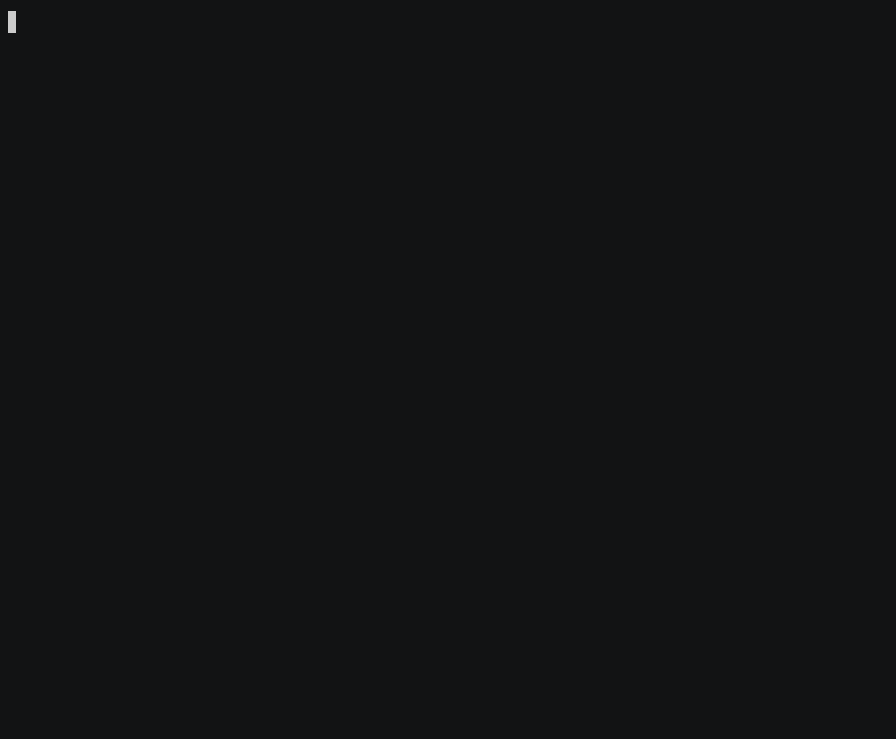

# CLAUDE.md

## 1. The documentation standard

This project writes every piece of documentation in ASD-STE100 Simplified
Technical English. This section governs every other section of this file.

The specification is not free to read. A future reader therefore cannot look the
rules up. This section writes the rules out in full. Apply exactly these rules.
Do not search for the specification.

### Why the project uses this standard

Simplified Technical English keeps text short, active, and clear. A reader who
does not speak English as a first language can then read the text correctly. A
machine translation of the text also stays correct.

### The nine rules

1. **One instruction in one sentence.** Keep a sentence that gives an
   instruction shorter than 20 words. Keep a sentence that describes something
   shorter than 25 words.
2. **Use the active voice.** Write `The function ignores a None value`. Do not
   write `None values are skipped`.
3. **Do not use the -ing form.** Write `Functions that operate on slices`. Do
   not write `Functions for working with slices`. The -ing form is permitted
   inside a technical name only. `Operating system` is an example of such a
   name.
4. **Write a complete sentence.** Do not remove a word to make a sentence
   shorter. Give every sentence a subject. The text `Returns the value,
   panicking on error` holds two faults: it uses an -ing form, and it has no
   subject.
5. **Use an article.** Write `an Ok variant`. Do not write `Ok variant`.
6. **Use one term for one thing.** Do not use a second word for variety. Select
   one of `returns an error` and `fails`. Then use that term everywhere. This
   project uses `returns an error`.
7. **Do not use slang, an idiom, or an undefined technical term.** Define each
   technical term where you first use it. The terms `zero-cost`, `footgun`, and
   `monadic bind` each need a definition, or a replacement.
8. **Keep the punctuation simple.** Do not use an em dash. Do not put a slash
   between two words. Use a vertical list for text that has several parts.
9. **Do not use an abbreviation that this project does not define.** Write
   `for example`. Do not write `e.g.`. Section 1.4 lists the abbreviations that
   this project defines.

### The one exception

The first line of a doc comment can keep the usual Rust form and start with a
verb. `Returns the parsed value` is an example. That line is the summary in the
generated documentation, and the standard permits a short form in a title.

Keep the usual headings: `# Examples`, `# Errors`, `# Panics`, and `# Safety`.

### What the standard covers

Apply the rules to all of these:

- `README.md`, and every other Markdown file;
- every `//!` crate comment and module comment;
- every `///` item comment, on a function, a struct, an enum, a trait, and a
  field;
- every `//` comment inside the code;
- the `description` field in each `Cargo.toml` file;
- the name of each test, and the message argument of `assert!` and `assert_eq!`;
- the text of each error, which includes every `#[error("...")]` attribute in a
  `thiserror` enum, and every `Display` implementation;
- the text that a person reads while the program runs. That text includes the
  constant `HELP` of `crates/thunderbox/src/main.rs`, which holds the text of the
  `--help` option. The program reads each argument itself, and it holds no
  library for that work. The text also includes each log message, and the
  message of each `expect` call.

### What the standard does not cover

- The code inside a doc-test fence. The lines between the two rows of three
  back quotes in a `///` comment are a test that the compiler runs. Rewrite the
  prose around the fence. Leave the code exactly as it is.
- A generated file, and code from another project.
- The text of a licence: `LICENSE-MIT` and `LICENSE-APACHE`.
- A string that a test compares against, when a change to that string would
  change what the program does. Section 1.5 lists those strings.

### 1.4 The abbreviations that this project defines

A writer can use these abbreviations without a definition:

| abbreviation | meaning |
|---|---|
| ADR | architecture decision record, a file that states one decision of the project |
| API | application programming interface |
| CA | certificate authority, an organization that signs the certificate of a server |
| CSV | comma separated values, a file format |
| GIF | Graphics Interchange Format, a file format that holds a short picture that moves |
| HTTP | HyperText Transfer Protocol, the rules that carry a request to a server |
| JSON | JavaScript Object Notation, a file format |
| LTTB | Largest Triangle Three Buckets, an algorithm that reduces the number of points in a series |
| PAM | Pluggable Authentication Modules, the system that Linux uses to check a password |
| PromQL | the query language of Prometheus |
| SQL | Structured Query Language |
| SSH | Secure Shell |
| TLS | Transport Layer Security, the rules that keep a connection private |
| TOML | Tom's Obvious Minimal Language, a file format |
| TTY | a plain terminal |

Add a row to this table before you use a new abbreviation.

### 1.5 The strings that the project did not change

A test compares against each of these strings. A change to the string would
change what a person sees, and it would also break the test. The project
therefore left them as they are.

| string | place | reason to keep it |
|---|---|---|
| `loading…` | `thunderbox-widgets`, the panel that has no answer yet | Rule 3 and rule 4 ask for "The data source has not answered yet." A panel can be eight cells wide. The long form does not fit. |
| `no data` | `thunderbox-widgets`, the panel that has an empty result | Rule 4 asks for a complete sentence. The same width problem applies. |
| `—` | `thunderbox-widgets`, the text of a value that is not finite | Rule 8 forbids an em dash as punctuation. This em dash is not punctuation. It is the symbol that a chart shows in place of a missing number. |
| `+3` | `thunderbox-widgets`, the note that counts the series, the columns, or the rows that a panel dropped, and the note that counts the panels that a collapsed row panel hides | Rule 4 asks for a complete sentence. The panel writes one, and it takes this form only where the sentence does not fit. No file holds this text. Each `dropped_text` function and the function `hidden_text` build the form with `format!("+{dropped}")` or `format!("+{hidden}")`. The tests compare against `+2`, `+3`, `+4`, and `+12`. |

### The rule for a short label inside a panel

The panels answered the question that the three strings above raise. A panel is
often eight cells wide, and no sentence fits in eight cells. The panels
therefore follow this rule:

1. Write the complete sentence, and measure it against the width.
2. Draw that sentence when it fits.
3. Draw the short form only when the sentence does not fit.

The function `dropped_text` in `thunderbox-widgets/src/panel.rs` holds this rule.
Three panels call it, so a reader meets the same words everywhere. A new short
label follows the same three steps, and it takes a row in the table above.

`thunderbox-widgets/src/table.rs` holds a second function of that name. The table
panel and the top panel call it. It counts a column for both panels, and it
counts a row for the top panel. The other three panels count a series, so the
two functions write different words. The two functions also measure the width
in different units. The function of `panel.rs` compares
`long.chars().count()`, and the function of `table.rs` compares
`display_width(&long)`. One character is not
always one cell, and `cells_of` of `panel.rs` states that rule. Change both
functions when you change this rule. Each function holds tests of its own, so a
change to one function alone leaves every test green.

`thunderbox-widgets/src/row.rs` holds a third function of this rule, and its
name is `hidden_text`. It counts the panels that a collapsed row panel hides,
and it measures the width with `cells_of`. Change it with the other two.

The first three strings stay as they are. They have no long form that fits, and
a test compares against each of them.

### How the project checks the standard

**No tool checks Simplified Technical English.** A reviewer reads the text and
checks it.

The script `scripts/ste-lint.py` finds the common faults. Run it with no
argument to check the whole project. It writes a file name and a line number for
each fault. Run `python3 scripts/ste-lint.py --selftest` to confirm that each
check still works.

The script finds a fault. It does not check the standard. A reviewer still reads
the text.

`.github/workflows/checks.yml` runs both commands of the script, and it runs
them before every other check. One fault in one Markdown file therefore ends the
run, and the workflow then compiles nothing. The build holds the common faults.
The build does not hold the standard.

### 1.6 The check that only a reader can make

The script checks four rules, and it checks each of those four only in part. No
tool checks the other five. Claude reads this file, so Claude is that reader,
and Claude must make this check before each commit.

The table below holds one row for each rule. Read the table together with the
next paragraph, which states the files that the script reads. A rule that the
script checks stays a rule for a reader in every file that the script does not
read.

| rule | who checks it |
|---|---|
| 1, the length of a sentence | The script counts 25 words. A sentence that gives an instruction has a limit of 20 words, and the script cannot tell those sentences apart. |
| 2, the active voice | A reader checks this rule. No tool checks it. |
| 3, no -ing form | The script finds the word. A reader decides whether the word is a technical name. |
| 4, a complete sentence | A reader checks this rule. No tool checks it. |
| 5, an article | A reader checks this rule. No tool checks it. |
| 6, one term for one thing | A reader checks this rule. No tool checks it. |
| 7, no slang and no idiom | A reader checks this rule. No tool checks it. |
| 8, simple punctuation | The script finds an em dash. A reader checks the slash between two words, and checks that a long list of parts became a vertical list. |
| 9, an abbreviation | The script finds `e.g.` and `i.e.`. A reader checks every other abbreviation against the table in section 1.4. |

Follow these steps before you commit a change to any file that section 1 covers:

1. Run `python3 scripts/ste-lint.py`. Correct each fault that it reports.
2. Read every sentence that your change adds, and every sentence that your
   change alters. Ask these five questions of each sentence:
   - Does the sentence name the actor, and does the actor come before the verb?
   - Does the sentence hold both a subject and a verb?
   - Does each noun hold an article?
   - Does the text use the same term as the text around it, for the same thing?
   - Can a reader who does not know this project understand each word?
3. Correct each sentence that fails a question.

A clean report from the script is not a pass. It means only that the common
faults are gone. Rule 2 and rule 6 fail in text that the script calls clean.

The script reads a file that ends in `.rs` and a file that ends in `.md`, and it
reads no other file. Inside a file that ends in `.rs` it reads a comment line
alone. Inside a file that ends in `.md` it drops a title line, a table, and a
fence. The list "What the standard covers" of section 1 is wider than
that. A reader therefore checks all nine rules in each of these:

- the `description` field of each `Cargo.toml` file;
- each comment of `.github/workflows/checks.yml`, of
  `.github/workflows/flake.yml`, of `.github/dependabot.yml`, and of
  `rust-toolchain.toml`;
- each comment of `flake.nix`, of `default.nix`, and of `.envrc`;
- each `description` field of `flake.nix` and of `default.nix`;
- each comment of a file under `dashboards`, and of
  `crates/thunderbox/src/default.toml`;
- each comment of `docs/book.toml`, of `docs/site.css`, and of
  `.cargo/config.toml`;
- the text that opens each file under `scripts`;
- each title line of a Markdown file;
- every string that a person reads on the screen.

The constant `HELP` is one such string. Each `#[error("...")]` attribute is
another. So is the message of each `assert!` call, and the message of each
`expect` call. The compiler holds every one of those inside a Rust expression,
and the script reads no Rust expression.

Most of the text in this project comes from Claude. This check therefore applies
to your own output, and not to the work of somebody else. Every fault that this
project has found so far sat in text that Claude wrote. Read your own sentences
with the same doubt that you would bring to the sentences of another writer.

### How to search by hand

A writer can also search by hand. Search for each of these:

- a word of four letters or more that ends in `ing`;
- an em dash;
- the abbreviation `e.g.`;
- the abbreviation `i.e.`;
- a sentence of more than 25 words.

Expect the word `operating` and other technical names to remain after the
search.

### 1.7 The verb of two words

Rule 7 forbids an idiom. A phrasal verb holds a verb and a short second word, as
`line up` does. A reviewer finds this fault in the text of this project more
often than any other fault. A reader sees plain English in such a verb, and the
script reports no fault. The two words together say something that neither word
says alone. A reader who does not speak English as a first language then meets a
word pair that no dictionary entry explains.

| phrase | replacement |
|---|---|
| `line up` | `start at the same cell` |
| `fall back to` | `take` |

Add a row when a reviewer finds another phrase.

Coverage of the documentation is a different matter from the style of the
documentation. A tool can check coverage. Section 2 records what the project
does today.

---

## 2. The lints for documentation coverage

The workspace holds four lints for documentation coverage, and each one is on
today. `Cargo.toml` declares all four:

| lint | the table of `Cargo.toml` that declares it |
|---|---|
| `missing_docs` | `[workspace.lints.rust]` |
| `rustdoc::broken_intra_doc_links` | `[workspace.lints.rustdoc]` |
| `clippy::missing_errors_doc` | `[workspace.lints.clippy]` |
| `clippy::missing_panics_doc` | `[workspace.lints.clippy]` |

Each lint holds the level `warn`. That level alone stops no command. Section 4
runs clippy with `-D warnings`, and it gives rustdoc the same flag through the
variable `RUSTDOCFLAGS`. A public item that holds no documentation therefore
fails the checks. Each lint reports zero faults today.

Before the rewrite the workspace held 113 items that had no documentation. The
rewrite of the comments documented each field and each variant, so that count is
now zero.

Never turn a new lint on while that lint still reports a fault. Report the count
of the faults first, and then agree the change.

### 2.1 Two rules that no other file states

**A crate takes these lints only when that crate declares them.** Each crate of
this workspace holds these two lines in its own `Cargo.toml` file:

```toml
[lints]
workspace = true
```

Write those two lines into the `Cargo.toml` file of each new crate. A crate that
omits them holds no lint of the four. No command reports that absence, and the
crate then passes every check with no documentation at all.

**`missing_docs` reads an item that a person outside the crate can reach.**
Several crates here hold a private module, and they export the items of that
module. The pair `mod frame;` and `pub use frame::Frame;` of
`crates/thunderbox-core/src/lib.rs` is such a shape. An item that stays inside a
private module reaches nobody outside the crate. The lint therefore reports no
fault for that item.

The measurement: `crates/thunderbox-core/src/reduce.rs` held a `pub struct` with
no comment, and `lib.rs` did not export it. `cargo clippy --all-targets --
-D warnings` then reported zero faults.

The count of zero above therefore covers the items that each crate exports. It
does not cover an item that a private module holds.

---

## 3. The project

thunderbox is a dashboard platform for the terminal. Read
`docs/contributor/architecture.md` first. It describes the parts of the program.
`docs/contributor/adr` holds one architecture decision record for each decision,
and its file `README.md` lists them. Read the records that govern the part that
you change. `docs/contributor/research.md` records the evidence for the choice
of each library.

`docs/user` holds the documentation for a person who uses thunderbox, and
`docs/contributor` holds the documentation for a person who changes it. Section
8 states the documentation that each feature holds. Section 9 states the rules
of the site that shows both folders. The site is at
`https://rellen.github.io/thunderbox/`.

`docs/contributor/open-findings.md` holds the findings of a sweep that no other
file records. Each item there names a fault of the code or of a document, with a
citation and a measurement. Read an item as a hypothesis until you check the
code. An item leaves that file when a change repairs it, or when a record of
the status Proposed takes it.

## 4. The commands that check the code

Run all of these before you commit:

```
python3 scripts/ste-lint.py --selftest
python3 scripts/ste-lint.py
cargo fmt --check
cargo clippy --all-targets --all-features -- -D warnings
cargo test
cargo test --doc
RUSTDOCFLAGS="-D warnings" cargo doc --no-deps
cargo xtask site check
cargo xtask site build
```

`.github/workflows/checks.yml` runs these nine checks, and it runs them in this
order. The two commands of the script come first, so one fault in one Markdown
file ends the run before the workflow compiles anything. The workflow sets
`RUSTDOCFLAGS` for every step, so the command `cargo doc --no-deps` there
carries no such prefix.

The workflow runs the last two commands on Linux alone. `cargo xtask site build`
needs the program `mdbook`, which the shell of section 4.4 holds. It also reads
the output of `cargo doc --no-deps`, so run that command first. Section 9 states
what these two commands check.

`RUSTDOCFLAGS` turns a warning of rustdoc into an error. Section 2 gives
`rustdoc::broken_intra_doc_links` the level `warn`, and `cargo doc --no-deps`
alone therefore returns 0 for a link that reaches nothing.

The measurement: one link to an item that does not exist gives
`cargo doc --no-deps` one warning and the code 0. The same link gives
`RUSTDOCFLAGS="-D warnings" cargo doc --no-deps` the code 101.

The count of the doctests must not fall. That count is 24 today:

| crate | doctests |
|---|---|
| `thunderbox-core` | 10 |
| `thunderbox-widgets` | 12 |
| `thunderbox-dashboard` | 1 |
| `thunderbox-source-prometheus` | 1 |
| each other crate | 0 |

No command compares the count against that number, and `cargo test --doc`
reports a crate that lost its last doctest as `0 passed`. Read the output of
each crate yourself. `thunderbox-dashboard` is the crate that a program embeds,
and one deletion takes it to zero.

### 4.1 The checks that this machine does not run

The workflow holds one step that the nine commands above do not hold. That step
compiles the workspace with release 1.88.0, which is the release that the field
`rust-version` of `Cargo.toml` names. The step runs on Linux alone.

`rust-toolchain.toml` pins release 1.98.0 for every command that a person runs
here. Code that needs a release newer than 1.88.0 therefore passes on this
machine, and it then fails in the workflow. Read the step `Check that the oldest
supported release compiles the workspace` when that failure arrives.

That step also passes `--locked`, and it is the one place in this repository
that passes it. Every command above lets Cargo write `Cargo.lock` again. Read
`git status` after the checks, and commit a change to that file on purpose.

The workflow runs every check on Linux and on macOS, with three exceptions. The
two commands `cargo xtask site check` and `cargo xtask site build` run on Linux
alone, and so does the step of release 1.88.0. `thunderbox-source-sysinfo`
reads this machine, and the crate `sysinfo` holds a separate implementation for
each operating system.

### 4.2 The command that reads every target

`cargo test` stops after the first target that fails, and this workspace holds
many targets. A change that breaks a rule in more than one target therefore
reports the failures of one target alone.

`cargo test --no-fail-fast` runs every target. Read that command when you want
the whole count, and read it always when you check a test against a change of
the code. Section 4.3 states that check.

The measurement: one change to `Snapshot::error_count` broke 4 tests of the
library and 9 tests of `tests/runtime.rs`. `cargo test` reported the 4, and
`cargo test --no-fail-fast` reported all 13.

`cargo test` also reports `0 failed` for a target that does not compile. Read
the output for the words `could not compile` before you believe a count of zero.

### 4.3 The check that a test really holds a rule

A test that passes states nothing by itself. A test that fails when the rule
goes states that it holds the rule.

Take this step for each rule that a change adds:

1. Take the rule out of the code. Write the opposite of the rule, or delete the
   line that holds it.
2. Run `cargo test --no-fail-fast`.
3. Read which tests fail. A rule that no test reports is a rule that the next
   change will break.
4. Put the rule back.

This project found three faults with that step. No reader found one of them in
the code alone. Two of the three were tests that this project had just written,
and each one passed while it held nothing. One drove no clock, so no set of
queries ever ran. The other named a terminal of 24 rows, and the renderer draws
every panel of that dashboard at 24 rows.

ADR 0032 in `docs/contributor/adr` holds the same step for the way from
`DashboardRuntime::set_panel_area` to `run_all`. This project has met that fault
on that path more often than on any other.

### 4.4 The flake

Nix is a package manager, and a flake is the file that tells Nix what a
repository offers. `flake.nix` offers the package of the program, and
`default.nix` holds that package. `flake.nix` also offers a shell that holds
each tool of section 4, of section 6, and of section 9. The shell holds the
program `mdbook` for the site of section 9.
`docs/user/how-to/install-thunderbox.md` gives the commands for a person who
installs the program. ADR 0055 and ADR 0056 record the decisions of the flake.

`nix develop` starts the shell. The flake reads the release of Rust from
`rust-toolchain.toml`, so the nine commands above then run with the pinned
release. A machine that holds no rustup otherwise runs them with another
release, and it reports nothing.

The measurement: one machine held no rustup, and its `cargo` reported release
1.96.1. Inside the shell on that machine, `cargo` reported release 1.98.0.

Run this command after a change to a Nix file, to `flake.lock`, to
`Cargo.lock`, or to `rust-toolchain.toml`:

```
nix flake check
```

The command builds each check of `flake.nix`. The first check is the package,
and the build of the package runs `cargo test` for the whole workspace. The
second check is the shell.

`.github/workflows/flake.yml` runs that command on Linux. `checks.yml` reads no
Nix file, so the workflow `flake` is the one check that builds the flake. It
starts only for a change to a file that its list `paths` names. A change under
`crates` starts no run. Press the manual button of that workflow after such a
change when the change can alter the build.

The flake offers three systems, and one of them has no build:

| system | who built the package |
|---|---|
| `x86_64-linux` | The workflow `flake` builds it. |
| `aarch64-darwin` | A person built it, with the sandbox of Nix on. |
| `aarch64-linux` | Nobody built it. |

The sandbox keeps a build away from the network and from the files of the
machine.

Five rules follow from the way that the flake builds the package:

- **The package names each path that the build reads.** The list `fileset` of
  `default.nix` holds `Cargo.toml`, `Cargo.lock`, `crates`, and `dashboards`.
  Code that includes a file from another directory compiles with `cargo`, and
  `nix build` then returns an error. Add the path to that list.
- **The overlay does not use the pinned release.** `packages.default` gives
  `default.nix` the release that `rust-toolchain.toml` names. `overlays.default`
  gives it the nixpkgs of the configuration that takes the overlay, and that
  nixpkgs holds a release of its own. No check builds the package of the
  overlay. A person built it one time, with the nixpkgs that `flake.lock` pins.
- **A new release of Rust can need a new `flake.lock`.** The flake takes each
  release from its input `rust-overlay`, and `flake.lock` pins one commit of
  that input. Dependabot raises the release in `rust-toolchain.toml` alone. Run
  `nix flake update rust-overlay` when Nix reports that it does not hold the
  release.
- **The package links one C library that `cargo` alone does not link.** nixpkgs
  tells the crate `aws-lc-sys` to link the library `aws-lc` of nixpkgs. `cargo`
  alone compiles that library from the source inside the crate. The package
  therefore needs `pkg-config` and `aws-lc`, and `default.nix` names both.
- **The check phase needs a file of CA certificates.** On Linux, a client of
  the data source prometheus reads the certificates of each CA from the
  machine. It returns an error when it finds none, even for an address of plain
  HTTP. The sandbox holds no such certificate. `nativeCheckInputs` of
  `default.nix` therefore names `cacert`, and the setup hook of that package
  sets the variable `SSL_CERT_FILE`.

The measurement of the last rule: without a CA certificate, 22 tests fail. The
log of the workflow `flake` named 3 of them, because `cargo test` stops after
the first target that fails.

`cargo test` cannot show that fault on a machine that holds a CA certificate.
Cargo replaced a variable `SSL_CERT_FILE` that named a file which did not
exist, and the test then read the file of the machine. Run the program of a
test directly to see the fault. The test
`the_error_of_the_client_names_its_cause` starts such a program.

---

## 5. The title of a pull request

A pull request that holds more than one commit takes its title from the first
commit. That title describes one commit, and it does not describe the whole
change. A person who reads the list of pull requests then reads the wrong
thing. The first commit of a change is often the groundwork, and the
groundwork is the part that a reader cares about least.

Write the title of such a pull request yourself. Follow these steps:

1. Read the subject of every commit in the pull request.
2. Write one sentence that covers all of them.
3. Replace the title with that sentence.

Section 1 governs that sentence, as it governs every other text of this
project.

A pull request that holds one commit keeps the subject of that commit. That
subject already describes the whole change.

### 5.1 No text names Claude as an author

No commit message and no description of a pull request names Claude as an
author. A trailer is a line of the form `Key: value` at the end of a commit
message. Do not write a `Co-Authored-By` trailer for Claude. Do not write a line
such as `Generated by Claude Code`. Do not write a link to the session of
Claude Code.

`.claude/settings.json` sets the fields `commit` and `pr` of `attribution` to
empty text, and it sets the field `sessionUrl` to `false`. Claude Code
therefore adds no such line itself. That file does not stop a writer who adds
the line by hand.

This project met that fault. The settings of one machine already hid the
attribution, and Claude still wrote the trailer by hand in each commit of one
session. On 2026-11-21, 24 of the 27 commits of `main` held the trailer
`Co-Authored-By: Claude Opus 5.5 <noreply@anthropic.com>`. Do not copy that
trailer from the history.

---

## 6. The picture in a pull request

thunderbox draws on a terminal. A diff holds the code that draws a panel, and it
does not hold the panel. A reviewer reads a description, and a reviewer does not
run the branch. A change that alters what a person sees therefore always holds a
picture. That rule binds every pull request. The picture sits in the description
of the pull request, and not in a comment. A description that holds no picture
and no reason is a fault.

A picture is a file in the GIF format, and `docs/media` holds each one. Keep
each picture under 200 kilobytes. The pictures of `docs/media` hold 16 kilobytes
to 197 kilobytes today, and `demo.gif` holds the largest of those. No command
measures a picture against the limit, and the workflow reads no file of
`docs/media`. Measure the picture yourself after you record a scene.

Two settings hold the size down. `--fps-cap 10` is the first, and the section
"The commands" below gives it. The list `steps` of the scene is the second. A
scene that sends more keys records more frames, and it therefore writes a larger
picture.

### The question that decides

Ask one question of the change. Does a person who runs the program see a
different screen?

These changes need a picture:

- a new panel, or a new part of a panel;
- a new colour, a new border, a new label, or a new axis;
- a change to the layout, or to the width of a chart;
- a new key, or a key that now selects a different panel;
- a change to the text that a person reads on the screen.

These changes need no picture:

- a change to a comment, or to a Markdown file;
- a change to a test, or to the name of an item in the code;
- a change to a type, or to the shape of a function;
- a change that only makes the program faster;
- a change that leaves every screen as it was.

A small change can still alter the screen, and it then needs a picture. Record a
picture when the answer is not clear. Then compare that picture against the
picture that `docs/media` already holds. Keep the old picture when the two show
the same screen. Then write one sentence in the description that says so.

### Every scene that a change reaches

The question above asks about one screen. A change often alters several screens.
Ask a second question of the change. Which scenes draw the thing that this
change altered?

Some text belongs to one panel, and one scene draws it. Other text belongs to a
whole program, and every scene of that program draws it. This table names the
text of the second kind:

| the text | where it lives | the scenes that draw it |
|---|---|---|
| the status row, which ends with the list of the keys | `status_text`, `KEYS` and `ROW_KEY` in `crates/thunderbox/src/main.rs` | `app`, `stack_none`, `stack_column`, `variables`, `too_small`, `rows`. The hint `ROW_KEY` appears in `rows` alone, because no other scene draws a dashboard that holds a row panel. |
| the row of the variables | `Variables::row_text` in `crates/thunderbox-dashboard/src/variable.rs`, and `VARIABLE_KEYS` in `crates/thunderbox/src/main.rs` | `variables` alone. The dashboard of every other scene declares no variable, and the program then draws no such row. |
| the row of the keys of an example | the text inside that example | the scene of that example alone |

`status_text` builds seven texts, and the table above names the scenes of the
last one alone. These are the other six:

- the count of the panels that hold an error;
- the sentence for a terminal that is too small;
- the sentence of the variables;
- the sentence that a dashboard writes while it waits;
- the window of time;
- the age of the numbers.

One scene draws the sentence for a terminal that is too small, and that scene is
`too_small`. `docs/user/how-to/read-a-dashboard-on-a-small-terminal.md` quotes
that sentence as the text beside the picture of that scene.

A change to a program that a scene records alters that scene, even when the
change leaves every panel as it was.
`crates/thunderbox-dashboard/examples/full_embed.rs` is such a program, and the
`full_embed` scene records it.

This project has already met that fault. One change bound the keys that move
and scale the time range. It gave new words to the list of the keys of the
program, and to the list of the same name inside `full_embed.rs`. Nobody
recorded either scene again, so `docs/media/demo.gif` and
`docs/media/full_embed.gif` each drew a list of keys that neither program drew.
A later change recorded both scenes again. The scene `panel_embed` draws a list
of its own, which the first change did not alter, so its picture stayed correct.

A wrong picture belongs to the next person who works on that scene. Record the
scene, and apply the test that this section already gives. Write the new picture
over the old picture when the two show a different screen. Do so even when your
own change did not make the difference, and name that repair in the description.

Do not record every scene of the project for a change that reaches one of them.

### The steps

1. Pick the scene that reaches the change. `docs/contributor/pictures.md` names
   each scene, what it records, and the page that shows its picture. The `app` scene reaches
   most changes, because the dashboard that it draws holds every type of panel.
   Pass `--cols N` and `--rows N` when the scene draws the change too small.
2. Build the program, record the scene, and write the picture. The next section
   holds the commands.
3. Write the new picture over the old picture of that scene under `docs/media`.
   Repeat step 1 and step 2 for each scene that the change alters.
4. Look at the picture. Each chart must hold points, and not boxes. The picture
   must show the change. Record the scene again when the picture fails.
5. Commit the picture by itself. Start the subject of the commit with
   `docs: record`. A new scene is the one exception, because that commit also
   holds `scripts/record-demo.py`, `docs/contributor/pictures.md`, and the page
   of `docs/user` that shows the picture.
6. Push the branch.
7. Read the identifier of the commit that holds the picture. The command below
   reads it for `docs/media/demo.gif`, and another picture takes its own path.
8. Write the picture into the description of the pull request. Section 6.1 gives
   the form of the address. Keep every word that the description already holds.
9. Write one sentence beside the picture. That sentence names the thing that a
   reviewer must look at. Give each picture a sentence of its own.

Push the branch before you read the identifier. GitHub draws no picture from a
commit that it does not hold.

```
git log -1 --format=%H -- docs/media/demo.gif
```

### The commands

Install `agg` once. A cast file holds what a terminal drew, and `agg` turns a
cast file into a picture:

```
cargo install --git https://github.com/asciinema/agg --locked agg
```

The shell of section 4.4 already holds `agg`. That `agg` reads Unifont from the
directory where Nix keeps each package. `agg` alone reads the fonts of the
machine. On a machine that holds no Unifont it writes
`no faces matching font family options`, and it writes no picture.

This command builds every program that a scene names:

```
cargo build --workspace --bins --examples
```

These two commands record the `app` scene and write its picture:

```
python3 scripts/record-demo.py app /tmp/demo.cast
agg --font-family "Unifont" --theme asciinema --fps-cap 10 \
    /tmp/demo.cast docs/media/demo.gif
```

The same two commands record another scene. Put the name of that scene in place
of `app`. Put the picture of that scene in place of `docs/media/demo.gif`.

Run each command from the root of the workspace. The script reads a path that
starts there, and it names that path when it finds no program.

Keep `--font-family "Unifont"`. A scene draws each point of a chart with a
braille character, which is a character that holds a pattern of dots. A font
that holds no such character draws a box in place of each point. No tool reports
that fault. Keep `--fps-cap 10` as well, because a larger number makes a larger
picture.

### When no scene reaches the change

`SCENES` in `scripts/record-demo.py` holds every scene. An entry needs the keys
`program`, `cols`, `rows`, and `steps`. The key `load` gives the machine work to
do. The key `dashboard` gives the scene a dashboard of its own.

No picture shows data of the machine that records it. Each scene therefore reads
the data source testdata, or data that its program makes itself. The function
`machine_fault` of the script stops a scene that runs `thunderbox` with no
dashboard, and a scene whose dashboard declares the data source `sysinfo`. The value of that
key is the whole text of a dashboard file, and not a path. The function
`stack_dashboard` of the same script builds such a text.

The script accepts a new name without any other change. Add a scene rather than
skip the picture. A new scene takes two more changes. Add a row to the table of
scenes in `docs/contributor/pictures.md`. Also draw the new picture in the page
of `docs/user` that describes the feature.

### 6.1 The address of the picture

A relative path such as `docs/media/demo.gif` draws a picture in a file of the
repository. It draws nothing in the description of a pull request. Write the whole address, in
this form:

```

```

The address follows two rules:

1. Name a commit, and never name a branch. A branch moves, and a person can
   delete it. A picture that names a branch then draws the wrong screen, or it
   draws nothing.
2. Write the identifier of the commit in full, with all 40 characters. A short
   identifier works only while no other commit of this repository starts with
   the same characters, and this repository grows.

Keep the host `github.com` and the segment `raw`, as the example shows, so
that each description uses one form of address.

**Read the description after you write it.** A description that a program
writes through the interface of GitHub can lose the `!` of a picture. The
picture then draws nothing, and the address stands as a link that a reviewer
must press. A description of this project has lost the `!` of a picture in
that way.

Write the picture in this form when that happens, which loses no character:

```

```

A push that replaces the history of a branch takes the old commit off that
branch. GitHub can then draw nothing for that address. Read the identifier again
after such a push, and write the address again.

### The sentence beside the picture

Every picture in a description carries a sentence of its own. That sentence
names the exact thing that a reviewer must look at. It also states what stood
there before the change. One description wrote this sentence beside its
picture:

> The stat tiles above read `core 0` and `core 1`. They read `random_walk{ser.`
> before this change, because the panel cut a name that no pattern had built.

The alternative text is the text between the two square brackets. A reviewer
reads it when the picture draws nothing. Copy the alternative text from the
page of `docs/user` that shows the same picture.

### The pages that show each picture

Each picture of `docs/media` appears in one page of `docs/user`, and
`docs/contributor/pictures.md` names that page. `README.md` shows
`docs/media/demo.gif` as well. A new picture of a scene keeps its file name, so
each of those pages draws the new picture immediately. Read every sentence of
each page that stands beside that picture. Correct each sentence that the new
picture does not match.

No check compares a picture against the program. The workflow in
`.github/workflows/checks.yml` never runs the script, so a picture that no
longer matches stays until a person sees the fault.

### When you cannot record a picture

Write the reason in the description of the pull request. Give the description
a section with the title `One thing this branch does not do`. Write these four
parts in that section:

1. the picture that this pull request does not record again;
2. the thing that a reviewer therefore cannot see;
3. the reason, with the measurement that proves it;
4. the pull request that will hold the new picture.

The later pull request records the picture, and its title names that work.

An inconvenience is not a reason. A slow script is not a reason. A machine that
cannot install `agg` is a reason. A screen that needs a data source that this
machine cannot start is also a reason. Name the command that failed, and quote
what it wrote.

### 6.2 A design that the project rejected belongs to the repository

A description often holds the reason that a design failed. A person who clones
this repository cannot read a description, so that reason then lives outside the
project.

Write such a reason into a decision record of `docs/contributor/adr` in the same
pull request. A design that the project examined and rejected takes a record of
the status Rejected. A question that the change leaves open takes a record of
the status Proposed, and that record names three things:

- the work that remains, and what it is worth;
- each design that the project rejected, with the fault that a reader measured
  in it;
- the question that the next design must answer.

The description of the pull request can then point at that record.

---

Section 1 governs every sentence of a description, as it governs every other
text of this project.

---

## 7. The merge rewrites a commit

This repository merges a pull request with a rebase. The merge writes a new
commit for each commit of the branch, and each new commit holds a new
identifier. The old commit stays in the repository, and it never reaches `main`.

Two rules follow.

**Never give a pull request the branch of another pull request as its base.**
That base branch does not survive the merge. GitHub then closes the second pull
request, and nobody can reopen it. The work must then return as a new pull
request.

**Compare the content to learn that a branch merged.** The commits of a merged
branch are not ancestors of `main`. Both `git branch --merged` and
`git merge-base --is-ancestor` therefore report a branch that did not merge.
This command reports the truth. It writes nothing when `main` holds every change
of the branch:

```
git diff the-branch origin/main
```

---

## 8. Each feature holds its documentation

A change that adds a feature, or that changes what a person sees or does, holds
its documentation in the same pull request. A pull request that changes a
feature and no document is a fault. In the same way, a pull request that
changes the screen and holds no picture is a fault. No tool checks this rule,
so a reader checks it before each commit.

### 8.1 The user documentation

`docs/user` holds four kinds of documentation, and the change updates each kind
that the feature reaches. This division follows Diátaxis, which is a method that
divides documentation by the need of the reader.

| kind | folder | when the change needs it |
|---|---|---|
| reference | `docs/user/reference` | Always. Each new field, key, kind of panel, data source, query, option, and message takes an entry. A changed fact changes its entry. |
| how-to guide | `docs/user/how-to` | When the feature serves a task that a person names. The title names that task. |
| explanation | `docs/user/explanation` | When the feature changes how a person must think about thunderbox. |
| tutorial | `docs/user/tutorials` | When a beginner meets the feature on the first path through the program. |

Follow these steps:

1. Search `docs/user` for each name that the change touches: each field, each
   key, each kind, each query. Correct each page that states the old fact.
2. Write each new page that the table above asks for. Add a row for it to
   `docs/user/README.md`. The command `cargo xtask site generate` then adds the
   page to the sidebar of the site.
3. Load each dashboard file that a page holds. A file that does not load is a
   fault of the page.

### 8.2 The contributor documentation

`docs/contributor` holds the documentation for a person who changes thunderbox.
The change updates it in these ways:

- Each decision that the change takes gets a record in `docs/contributor/adr`.
  Copy `0000-template.md`, take the next free number, and add a row to the
  table of `README.md` of that folder. The command `cargo xtask site generate`
  then adds the record to the sidebar of the site.
- Each question that the change leaves open gets a record of the status
  Proposed. Each design that the change examined and did not take gets a
  record of the status Rejected. Section 6.2 states what such a record holds.
- A record never changes its decision. A new decision takes a new record, and
  that record supersedes the old one.
- A change to the parts of the program, or to the way between them, changes
  `docs/contributor/architecture.md`. A new feature also takes a row in the
  table of the features of that file.
- A code comment cites a record by its number, in the form
  `ADR 0021 in docs/contributor/adr`.

Section 1 governs every page of both folders, as it governs every other text of
this project.

---

## 9. The documentation site

The project publishes `docs` as a site at `https://rellen.github.io/thunderbox/`.
mdBook is a program that builds a site from Markdown files. GitHub Pages is the
service of GitHub that serves the site. ADR 0066 in `docs/contributor/adr`
records the decision. ADR 0067 records the designs that the project rejected.
ADR 0068 states the question that remains.

### 9.1 The parts of the site

The site holds three parts, and it holds the API documentation:

- The home page shows the program and names the other parts.
- The part "Use thunderbox" holds the pages of `docs/user`.
- The part "Work on thunderbox" holds the pages of `docs/contributor`. It also
  holds the page `docs/contributor/rules.md`, which shows this file.
- The folder `api` of the site holds the output of `cargo doc --no-deps`. This
  folder holds no page of its own, because `cargo doc --no-deps` writes no
  `index.html` at the root of `target/doc`. The crate table of the site links
  to the page of each crate.

These files hold the site:

| file | what it holds |
|---|---|
| `docs/book.toml` | The configuration of mdBook. It names `docs` as the source, `target/book` as the output, and the preprocessor of links. |
| `docs/SUMMARY.md` | The sidebar of the site. The command `cargo xtask site generate` writes it. |
| `docs/index.md` | The home page. A person writes it, and the generator writes the crate table in it. |
| `docs/site.css` | The style of the home page. |
| `docs/contributor/rules.md` | The page that shows this file. |
| `crates/xtask` | The program that generates and checks the files, builds the site, and rewrites each link. |
| `.cargo/config.toml` | The alias that lets `cargo xtask` run the crate `xtask`. |

### 9.2 The commands

These commands build the site on this machine. Run them from the root of the
workspace:

```
cargo doc --no-deps
cargo xtask site generate
cargo xtask site check
cargo xtask site build
python3 -m http.server --directory target/book
```

Each command has one task:

- `cargo xtask site generate` writes the sidebar and the crate tables.
- `cargo xtask site check` returns an error when a generated part is not
  current.
- `cargo xtask site build` runs mdBook, copies `target/doc` into
  `target/book/api`, and checks every internal link of the built pages.
- `python3 -m http.server` serves the site at `http://localhost:8000/`.

The program `mdbook` comes from `nix develop`. The command
`cargo xtask site build` returns an error when it finds no `mdbook`, and when
`target/doc` does not exist.

### 9.3 The rules of the site

- **A new page takes a row in a table.** Add a row for the page to the table of
  the nearest `README.md`. Then run `cargo xtask site generate`, which writes
  the sidebar from those tables. The generator returns an error for a page that
  no table names. The reason: plain `mdbook build` skips a Markdown file that
  `SUMMARY.md` does not name, and it still returns 0. The measurement: such a
  file gave the code 0 and printed only lines of the level INFO. The site would
  then hold no such page, and no check would say so.
- **No person edits a generated part.** The generated parts are
  `docs/SUMMARY.md` and the text between the lines `<!-- crates:begin -->` and
  `<!-- crates:end -->`. Edit the source of the part instead. The source is a
  row of a table, or the `description` field of a `Cargo.toml` file. The
  command `cargo xtask site check` returns an error when a generated part is
  not current, and the workflow runs it.
- **The crate table comes from two sources.** The `description` field of each
  `Cargo.toml` file gives the text of a row. The command `cargo metadata` gives
  the list of the crates. The generator returns an error for a crate that has
  no description.
- **Each relative link must work on the site.** A page of `docs` also reads on
  GitHub, so its links name files of the repository. A preprocessor is a
  program that mdBook runs on each page before it builds the site. The
  preprocessor `cargo xtask mdbook-preprocessor` changes each such link. A link
  to a page stays a link to a page. A link to another file or folder of the
  repository becomes a link to GitHub on the branch `main`.
  `cargo xtask site build` then checks every internal link of the built pages,
  and it returns an error for a link that reaches nothing.
- **mdBook has one release in two places.** `checks.yml` names the release in
  the line `mdbook@0.5.4`. The shell takes mdBook from the nixpkgs that
  `flake.lock` pins. Raise both places together. Dependabot raises the tag of
  the action `taiki-e/install-action`, and it does not raise the number after
  `mdbook@`. Run `mdbook --version` in the shell after `nix flake update`.
  Compare the answer with that number.
- **A pull request builds the site, and only `main` publishes it.** The step
  that builds the site runs for every pull request, so a fault reaches the
  reviewer. Only a run on `main` uploads the site. The job `deploy` then
  publishes it, after both jobs of the matrix pass. The environment
  `github-pages` accepts a deployment from `main` alone. The workflow never
  cancels a run on `main`, because a cancel could stop a deployment before it
  ends.
- **This file holds no include directive of mdBook.** An include directive is a
  line that tells mdBook to copy a file into a page. The page
  `docs/contributor/rules.md` includes this file, so an include directive in
  this file makes mdBook include the file again without end. Do not write that
  directive here. mdBook also reads the directive inside back quotes and
  inside a fence. The measurement: a directive inside back quotes in an
  included file made mdBook print
  `ERROR Stack depth exceeded in a.md. Check for cyclic includes`.
- **The page that shows this file is `rules.md`.** Never name it `claude.md`.
  Claude Code loads the file `CLAUDE.md` of each folder as a file of
  instructions. macOS ignores the case of a name, so Claude Code also loads a
  file `claude.md` in that way.

Section 1 governs every page of the site, as it governs every other text of
this project.
