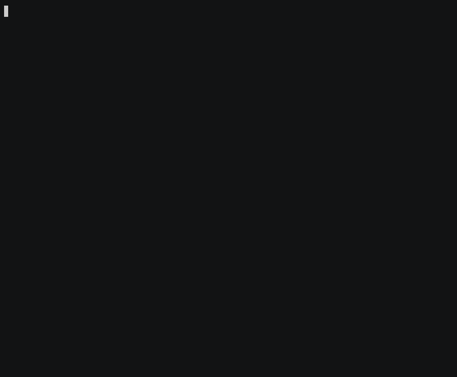
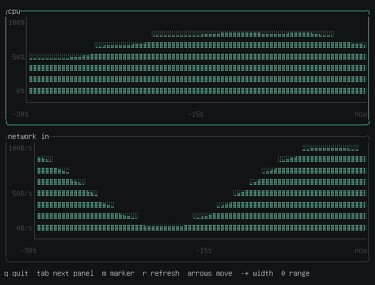
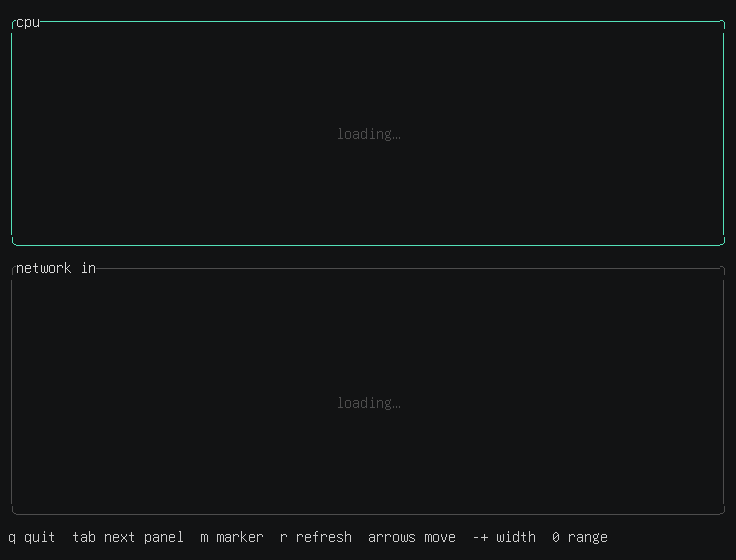
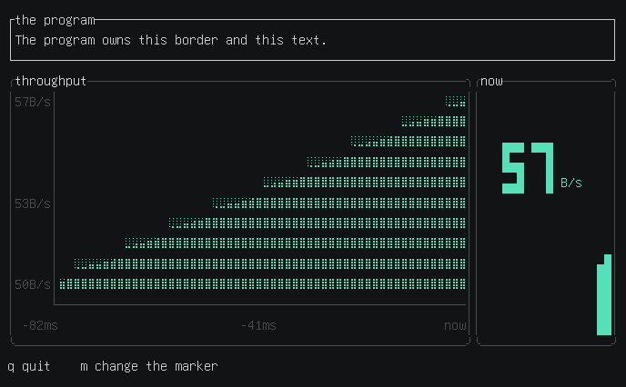

# thunderbox

A dashboard platform for the terminal. It has the shape of Grafana. A person
writes a dashboard as a document, and the dashboard reads its data from data
sources that a person can add.

thunderbox stores a dashboard. It never stores a measurement. The system that
thunderbox queries keeps the measurements.



## Run it

```
cargo run -p thunderbox
```

The program reads this machine. It draws the processor, each core, the memory,
the network, and the processes. The picture above draws the same panels over
the data source testdata. No picture of this project shows data of the machine
that records it. Name a file to show your own dashboard:

```
cargo run -p thunderbox -- my-dashboard.toml
```

These keys work:

| key | what it does |
|---|---|
| `q` or `Esc` | Stop the program. |
| `Tab` | Select the next panel. |
| `Shift+Tab` | Select the panel before. |
| `m` | Change the glyph that a chart draws a point with. |
| `r` | Run the queries again. |
| `Left` | Move the time range back by half of its width. |
| `Right` | Move the time range forward by half of its width. |
| `-` | Make the time range twice as wide. |
| `+` | Make the time range half as wide. |
| `0` or `=` | Return to the time range that the dashboard states. |
| `v` | Select the next variable of the dashboard. |
| `]` | Take the choice that follows, on the variable that you selected. |
| `[` | Take the choice before it, on the variable that you selected. |

Every panel shares one time range. A window is the pair of moments that a time
range names, and the moment that named them. A move fixes a moment at each end,
so the window stands still and the status row names it. A move forward that
reaches the present moment returns a range that follows the clock again, and it
keeps the width that a person chose.

thunderbox consumes no key of the time range, and it consumes no key of a
variable. The functions `thunderbox_dashboard::time_key` and
`thunderbox_dashboard::variable_key` offer a default map from such a key, and each
one holds its rule alone. A program that holds a thunderbox dashboard decides
which key reaches each map, and a program that wants another map ignores those
functions.

## A dashboard

A dashboard is a TOML file. It names its data sources, and it places each panel
on a grid that is 24 columns wide.

```toml
title = "system"
refresh = "1s"

[time]
from = "now-5m"
to = "now"

[source.machine]
kind = "sysinfo"

[[panel]]
title = "cpu"
kind = "timeseries"
unit = "percent"
grid = { x = 0, y = 0, w = 16, h = 8 }

[[panel.target]]
source = "machine"
expr = "cpu"

[[panel]]
title = "cpu now"
kind = "stat"
unit = "percent"
grid = { x = 16, y = 0, w = 8, h = 8 }

[[panel.threshold]]
value = 85.0
color = "critical"

[[panel.target]]
source = "machine"
expr = "cpu"
```

These settings sit at the top of the file, outside every panel:

| setting | what it does |
|---|---|
| `title` | The name of the dashboard. This name must not be empty. |
| `refresh` | The time between two refreshes, as a duration. |
| `align` | The rule that gives one width to the charts of a stack. |
| `[time]` | The time range that every panel shares. |

## The panels

A panel states its type in the `kind` field. Every type reads the same frames,
and no type names a data source.

| kind | what it draws |
|---|---|
| `timeseries` | One or more values against time, as a chart. |
| `stat` | One large number for each series. |
| `gauge` | One value against a range, as a meter. |
| `bargauge` | One bar for each series, against a range. |
| `table` | The columns of the frames, as rows and columns. |
| `top` | A list of rows in order by one column, with the largest value first. The program `top` shows its processes in this form. |

The stat panel, the gauge panel, and the bar gauge panel each show one number
for each series. Each one reduces the column of numbers to that one number
first. The `reduce` field names the step:

| step | the number that it returns |
|---|---|
| `last` | The most recent value. This step is the default. |
| `first` | The oldest value. |
| `min` | The smallest value. |
| `max` | The largest value. |
| `mean` | The mean of every value. |
| `sum` | The sum of every value. |
| `count` | The number of values that the column holds. |

These fields of a panel control how it shows a number:

| field | what it does |
|---|---|
| `unit` | The name of the unit. The formatter knows `percent`, `bytes`, `bytes/s`, and `seconds`. |
| `decimals` | The number of decimal places. |
| `min` and `max` | The range of a meter. A gauge and a bar gauge read this range. |
| `reduce` | The step that turns a column of numbers into one number. |
| `sort` | The column that puts the rows of a top panel in order. Only a top panel reads this field. |
| `[[panel.threshold]]` | A bound, and the colour above that bound. The colours are `warning` and `critical`. |

A data source can attach the same settings to a column of its answer. The panel
wins where the two disagree, because a person wrote the panel. A top panel is
the one exception, and the next section states it.

### The top panel

A top panel puts the rows of its frames in order by one column. The row that
holds the largest number comes first, and the panel shows the first rows that
fit. The `sort` field names the column by the text of its header. A panel that
states no `sort` field takes its first column of numbers.

```toml
[[panel]]
title = "processes"
kind = "top"
sort = "cpu"
grid = { x = 12, y = 13, w = 12, h = 6 }

[[panel.threshold]]
value = 85.0
color = "critical"

[[panel.target]]
source = "machine"
expr = "processes"
```

The panel follows these rules:

- Two rows that hold the same number keep the order of the data. Most processes
  of a machine use no share of the processor, and those rows then stay still
  on each refresh.
- A row that holds no number in the column comes last.
- The panel puts the rows of every frame into one list. A column of one frame
  joins the column of another frame that shows the same header.
- The bottom border counts the rows that do not fit. The text
  `312 rows do not fit.` is an example.
- A line under a header marks the column that gives the order.
- The settings of the panel describe the column that gives the order, and no
  other column. Every other column keeps the settings that its data source
  states. A list of processes holds a share of the processor beside a count of
  bytes, and one unit cannot describe both.

The panel draws an error in place of the rows when no column of numbers shows
the header that the `sort` field names. thunderbox rejects a `sort` field on a
panel of any other kind.

## Give one width to a stack of charts

A stack is the set of panels that hold the same columns of the grid, one above
another. A chart keeps a column of cells at its left edge. That column holds the
labels of the axis of values. The chart takes the width of that column from its
own widest label. A panel that shows a share of use writes `100%`, and a panel
that shows a rate writes `8.3GB/s`. The second chart therefore starts further to
the right. A person who reads one panel above the other reads two axes of time
that start at different cells. One moment then stands in two places.

The `align` field states what a dashboard does about that:

| value | what the renderer does |
|---|---|
| `none` | Each panel measures its own labels. This value is the default value. |
| `column` | Every chart of a stack starts at the same cell. |

```toml
title = "system"
align = "column"
```

A dashboard that states no rule draws this picture. The chart of the share of
use starts four cells to the left of the chart of the rate. The labels of the
two axes of time also stand in different places:



The same dashboard under `align = "column"` draws this picture. Both charts
start at the same cell, and one moment stands in one place:



The rule reaches the panels that state the same `x` and the same `w`. Two panels
of different widths keep their own measurements, because two such charts cannot
start and end at the same two cells. A chart gives no more than a third of its
width to the labels. A stack of wide labels in a narrow terminal therefore keeps
that third.

A program that draws one panel at a time reaches the same rule through
`TimeSeriesPanel::measure_label_width` and `TimeSeriesPanel::label_width`.

## The targets of a panel

A panel reads its data from one target or more. A target holds these fields:

| field | what it does |
|---|---|
| `source` | The name of a data source that the dashboard declares. |
| `expr` | The text of the query. Only the data source reads this text. |
| `legend` | The pattern that names each series of the answer. |

thunderbox reports a fault for a `source` that names a data source which the
dashboard does not declare. It reports that fault only when the dashboard
declares at least one data source. A dashboard that declares no data source
therefore accepts any name, and each panel that holds a target then holds an
error. Section 12 of `docs/ARCHITECTURE.md` states the reason.

The `legend` field puts the value of a label in the place of a name between two
pairs of brace brackets. The reserved word `{{__name__}}` reads the name of the
column itself.

The name of a label holds no brace bracket. A pattern that holds one there is
not correct, and thunderbox shows that text without a change. The pattern
`{{{instance}}}` is an example.

Every data source obeys this rule. thunderbox applies the pattern after the data
source answers, and a data source applies no pattern of its own.

Each data source names its columns and its labels in its own way. A person
therefore writes a different pattern for each one:

**`sysinfo` attaches one label, and it attaches that label to one signal.** The
signal `cpu.cores` returns one series for each core that the machine reports.
Each of those series carries the label `core`, and the value of that label is
the position of the core. Write `{{core}}`:

```toml
[[panel.target]]
source = "machine"
expr = "cpu.cores"
legend = "core {{core}}"
```

That target shows `core 0`, `core 1`, and one name for each other core of the
machine. The default dashboard of the `thunderbox` program holds that target, so
`cargo run -p thunderbox` shows the rule. This data source also names each column
after that position, so `{{__name__}}` gives the same name.

Every other signal of `sysinfo` returns one series. No property separates one
series of such a signal from another series of it, so those signals carry no
label. The signal `cpu` is an example, and `{{__name__}}` names it.

**`testdata` gives every column the text of the query as its name.** It gives
each series a different value of the label `series`, so `{{__name__}}` there
gives one name to every series. Write `{{series}}` instead.

**`prometheus` moves the name of a metric into the name of the column.** The
pattern `{{__name__}}` therefore reads that name, and a label of the query gives
one name for each series:

```toml
[[panel.target]]
source = "prom"
expr = 'rate(node_cpu_seconds_total{mode="user"}[5m])'
legend = "{{instance}}"
```

A query that drops the name of a metric asks for a different pattern. The query
`sum by (instance) (up)` returns a series that holds the label `instance` and no
name of a metric. thunderbox then names the column after the text of the query, so
`{{__name__}}` gives one name to every series of that panel. Write
`{{instance}}` for such a query. A label gives one name for each series, and
that name is short.

`dashboards/prometheus.toml` needs no change, because each target of that file
states `{{instance}}`. A dashboard that states `{{__name__}}` on a query that
drops the name of a metric shows one name for every series of the panel.

## The variables that a person selects

A variable holds a value that a person changes while the program runs. A target
refers to that value, and the value reaches the data source in the place of the
reference. One dashboard therefore serves every machine, every job, and every
signal that a person wants to read.

A dashboard declares a variable in a `[[variable]]` table:

```toml
[[variable]]
name = "signal"
label = "the signal"
options = ["random_walk", "sine", "ramp", "gappy"]
current = "random_walk"

[[panel.target]]
source = "test"
expr = "$signal"
```

A variable holds these fields:

| field | what it does |
|---|---|
| `name` | The name that a target refers to. A target writes `$name`. |
| `label` | The name that a person reads. The row of the variables shows it. |
| `options` | The fixed choices. |
| `query` | The query that holds the choices. A variable states `options` or `query`, and never both. |
| `current` | The choice that is active when the program starts. The variable takes its first option when the dashboard states no such field. |

`dashboards/variables.toml` holds a whole dashboard of this form. It reads the
test data of this project, so it needs no server. Run it with this command:

```
cargo run -p thunderbox -- dashboards/variables.toml
```

That dashboard draws this picture. The row at the top names the variable and
the choice that stands. The key `]` takes the choice that follows, and every
panel then draws the signal that the row names:

![A row of variables stands above three panels. The key `]` takes the choice that follows, and every panel draws the new signal.](docs/media/variables.gif)

### How a target refers to a variable

The character `$`, and then the name of a variable, is a reference. A name
starts with a letter or an underscore, and it then holds letters, digits, and
underscores. A reference therefore ends at the first character that no name
holds, and a person writes `up{job="$job"}` with no mark around the name.

The text `$$` writes one `$`, and it refers to nothing. A person writes `$$` for
a query language that reads `$` in its own way. Every other `$` stays as it is,
so the text `$1` reaches the data source without a change.

thunderbox reads the text one time. A value that itself holds a reference reaches
the data source as it is, so one variable cannot reach another.

A reference reaches the `expr` field of a target. It reaches no other field, so
the `legend` field holds no reference to a variable.

### The choices that a data source holds

A variable that states a `query` takes its choices from a data source:

```toml
[[variable]]
name = "instance"
label = "the machine"
query = { source = "prom", expr = "instance" }
```

The data source reads the text of that query in its own way. The prometheus
data source reads the name of a label, and it returns every value of that
label. The sysinfo data source returns the name of each signal that it holds,
and the query `processes`.
A data source that holds no choice for a variable reports that in the status
row.

thunderbox asks the data source one time, when the program starts. The variable
holds the value of its `current` field until that data source answers. It then
keeps that value when the answer holds it, and it takes the first choice in
every other condition.

### What thunderbox rejects

thunderbox reads the whole dashboard before it draws. It reports a fault in each
of these conditions, and it names the variable:

- a variable has a name that no query can refer to;
- two variables carry one name;
- a variable states no choice, or it states its choices in two places;
- a variable states a `current` value that is not one of its options;
- a variable names a data source that the dashboard does not declare;
- the query of a variable refers to a variable;
- a panel refers to a variable that the dashboard does not declare.

## The data sources

A dashboard declares each data source that it needs. The `kind` field states the
type, and each type reads its own options.

| kind | what it reads |
|---|---|
| `sysinfo` | This machine. |
| `prometheus` | A Prometheus server. |
| `testdata` | Values that this project makes, for a test and for a demonstration. |

**`sysinfo` reads this machine.** It takes no option, and it holds these
signals:

| signal | what it reports | unit | label |
|---|---|---|---|
| `cpu` | The share of the processor in use, across every core. | percent | none |
| `cpu.cores` | The share of each core in use. One series for each core that the machine reports. | percent | `core` |
| `memory` | The share of the memory in use. | percent | none |
| `memory.bytes` | The memory in use. | bytes | none |
| `swap` | The share of the swap area in use. | percent | none |
| `network.rx` | The bytes that the network cards received in each second. | bytes/s | none |
| `network.tx` | The bytes that the network cards sent in each second. | bytes/s | none |
| `processes` | The data source returns one row for each process of the machine. The section below states the columns. | percent and bytes | none |

The label `core` holds the position of the core in the list that the machine
returned. The machine decides what that list holds. It reports one entry for
each stream of instructions that it can run. A machine that runs two streams on
one piece of hardware therefore reports two entries for that piece. The count of
the series can be twice the count of the hardware.

The series come in the order of that position. The store of this data source
orders its names by the text, so `cpu.core.10` comes before `cpu.core.2` there.
A panel drew that order before this rule, and a machine of ten cores or more
therefore drew `core 0, core 1, core 10, core 11, core 2`. It now draws
`core 0, core 1, core 2` and so on.

The project names this label `core`, and not `cpu`. The signal is `cpu.cores`,
and the store of this data source names each series `cpu.core.0` and so on. One
term therefore names one thing inside this data source. The name `cpu` would
name both a signal and a label. Prometheus names the same property `cpu` in
`node_cpu_seconds_total{cpu="0"}`, so a person who reads both data sources
writes two patterns. A dashboard holds no version number, so thunderbox cannot
rename this label later without a silent change to every dashboard that reads
it. The name therefore stands here, beside the signal that carries it.

A variable of this data source takes the name of a signal, and not the value of
a label. `sysinfo` returns the names of the signals for every such question. The
section "The variables that a person selects" above states how a dashboard
declares such a variable.

The `sysinfo` data source keeps its own store of samples. The machine reports
its state at one moment, and a panel draws values against time. The store fills
while the program runs. It holds nothing from before the program
started, and the distance between two samples equals the refresh interval of
the dashboard.

The query `processes` reads no store. It returns one frame, and that frame
holds one row for each process and these four columns:

| column | what it holds | unit |
|---|---|---|
| `pid` | The number of the process, as text. A column of numbers would write `1.2K` for the process 1234. | none |
| `name` | The short name of the program that the process runs. | none |
| `cpu` | The share of the processor since the sample before. A value of 100 is one whole core, as in the program `top`. | percent |
| `memory` | The memory that the process holds in physical memory. | bytes |

A top panel draws this frame. The rows come in the order of the number of each
process, and the panel puts them in its own order. The first sample reports a
share of 0 for each process, because the data source needs two samples before
it can report a share. The data source keeps no list from the past. A window
that a person moved into the past therefore shows `no data` in that panel. The
list counts each process one time, and it counts no thread of a process as a
row of its own.

**`testdata` makes test data.** It needs no server, and the data does not change
between two runs. The queries are `random_walk`, `sine`, `ramp`, and `gappy`.
The query `processes` returns a list of twelve invented processes, in the
shape of the list of `sysinfo`. Each value of that list depends on the end of
the window alone. The data source takes two options:

| option | what it does |
|---|---|
| `seed` | Two data sources that have a different seed make a different signal. |
| `series` | The number of series that one query returns. |

**`prometheus` reads a Prometheus server.** The query text is PromQL, which is
the query language of Prometheus. It takes the `url` field and three options:

| field or option | what it does |
|---|---|
| `url` | The address of the server. A user name and a password in that address reach the server as a header of the kind `Basic`. |
| `name` | The name that thunderbox shows for this data source. |
| `min_step` | The smallest distance between two points. Set it to the interval at which the server collects the metric. |
| `timeout` | The longest time that thunderbox waits for an answer. |

```toml
[source.prom]
kind = "prometheus"
url = "http://127.0.0.1:9090"
min_step = "15s"

[[panel]]
title = "cpu"
kind = "timeseries"
unit = "percent"
grid = { x = 0, y = 0, w = 24, h = 10 }

[[panel.target]]
source = "prom"
expr = 'rate(node_cpu_seconds_total{mode="user"}[5m])'
legend = "{{instance}}"
```

`dashboards/prometheus.toml` holds a whole dashboard of this form. Run it with
this command:

```
cargo run -p thunderbox -- dashboards/prometheus.toml
```

thunderbox asks the server for the number of points of one panel. It never asks
for the number of points of the whole screen. Each panel holds a width of its
own on the grid, so each panel asks for a number of its own. A panel that is 80
cells wide and that draws with a braille marker asks for 160 points. A panel of
37 cells beside it asks for 74 points. thunderbox turns each number into the step
of the query, and the server does the work. The step is the distance between two
points. A build without the `prometheus` feature reads this machine and the test
data alone.

thunderbox draws no panel under 3 cells wide or under 3 cells high, and it drops
such a panel. It asks a server for nothing at all for a panel that it drops. A
terminal that is too small therefore costs no request, and the status row counts
the panels that thunderbox dropped.


The dashboard of that picture holds three panels. The first one holds 4 rows of
the grid, and each of the other two holds 12 rows. The terminal gives the panels
18 rows, so the first panel holds 2 cells. thunderbox drops it, and it asks the
data source for the points of the other two panels alone.

## Put thunderbox inside another program

thunderbox offers two ways to do this. Each one is a crate.

**`thunderbox-widgets` draws a panel.** Use this crate when your program
already holds its own data. The crate needs no terminal backend and no async
runtime. Your program keeps its terminal, and it passes the data as frames.

```
cargo run -p thunderbox-widgets --example panel_embed
```



**`thunderbox-dashboard` runs a whole dashboard.** Use this crate when thunderbox
should run the queries for you. Your program keeps its terminal, its event
loop, and its key bindings, and it passes an async runtime handle to thunderbox.

```
cargo run -p thunderbox-dashboard --example full_embed
```


Both examples are short, and each one shows the whole connection between a
program and thunderbox.

## The marker

A terminal cell holds one character. Some characters divide the cell into
smaller parts, so a chart can draw more points than the terminal has cells.
This project calls each such part a sub-cell.

| setting | sub-cells in one cell | note |
|---|---|---|
| `braille` | 2 across, 4 down | Most fonts hold these characters. This is the default. |
| `octant` | 2 across, 4 down | No space separates one cell from the next, but the characters need a font that holds Unicode 16. |
| `halfblock` | 1 across, 2 down | Every font holds these characters. |
| `block` | 1 across, 1 down | For a plain terminal. |

The `m` key moves between them.

## The release of Rust

This project pins the release of Rust. The file `rust-toolchain.toml` names it.
rustup reads that file, and it then uses that release for every cargo command
inside this directory tree. The pin holds the output of clippy and of
`cargo fmt` still, for a person and for the checks that GitHub runs.

rustup installs the release by itself when the machine does not hold it. A
person who turned that behaviour off runs this command once:

```
rustup toolchain install
```

The command reads `rust-toolchain.toml`. It installs the release, the profile,
and the components that the file names.

Only rustup reads this file. A `rustc` that a package manager installed ignores
the file, and it reports nothing. Install rustup from https://rustup.rs to get
the pinned release.

## The documents

- `docs/ARCHITECTURE.md` records the design and the decisions.
- `docs/RESEARCH.md` records the evidence for the choice of each library.
- `CLAUDE.md` records the standard that every document in this project follows.

## Make the picture again

`scripts/record-demo.py` starts the program inside a pseudo-terminal, sends a
list of keys, and writes a cast file in the asciinema format. The `agg` program
then turns that file into a GIF. Install `agg` with this command:

```
cargo install --git https://github.com/asciinema/agg --locked agg
```

Then run these commands. The first one builds every program that a scene names:

```
cargo build --workspace --bins --examples
python3 scripts/record-demo.py app /tmp/demo.cast
agg --font-family "Unifont" --theme asciinema --fps-cap 10 \
    /tmp/demo.cast docs/media/demo.gif
```

The first argument names the scene. Each scene names its own program and its
own list of keys. The scenes are these:

| scene | what it records |
|---|---|
| `app` | The whole program, over the layout of the dashboard that it holds, with the data source testdata. |
| `panel_embed` | The example that draws one panel. |
| `full_embed` | The example that holds a whole dashboard. |
| `stack_none` | Two charts in one column, under no rule. |
| `stack_column` | The same two charts, under the rule `align = "column"`. |
| `variables` | The row of the variables, and the panels that a choice changes. |
| `too_small` | A terminal that is too small for one panel of its dashboard. |

The two scenes of the stack hold a dashboard of their own. The script writes
that dashboard to a file, and it gives the path of that file to the program.
The two dashboards differ in one line, which is the line that states the rule.
Record both scenes with these commands:

```
python3 scripts/record-demo.py stack_none /tmp/stack_none.cast
python3 scripts/record-demo.py stack_column /tmp/stack_column.cast
agg --font-family "Unifont" --theme asciinema --fps-cap 10 \
    /tmp/stack_none.cast docs/media/stack_none.gif
agg --font-family "Unifont" --theme asciinema --fps-cap 10 \
    /tmp/stack_column.cast docs/media/stack_column.gif
```

No scene reads this machine. The script stops before it records a scene that
runs `thunderbox` with no dashboard, or a scene whose dashboard declares the data
source `sysinfo`. The `app` scene therefore draws the layout of the dashboard
inside the program, with the data source testdata in place of `sysinfo`.

The font matters. A recorder draws a box in place of each character that its
font does not hold. Unifont and FreeMono both hold every braille character.
DejaVu Sans Mono and JetBrains Mono hold none of them.

## Licence

thunderbox is free software. You can use it under the MIT License, or under the
Apache License, version 2.0. Select the licence that suits you. `LICENSE-MIT`
and `LICENSE-APACHE` hold the two texts.

Unless you state otherwise, you license each contribution that you submit to
this project under both licences, with no other terms. The Apache License,
version 2.0, defines a contribution.
