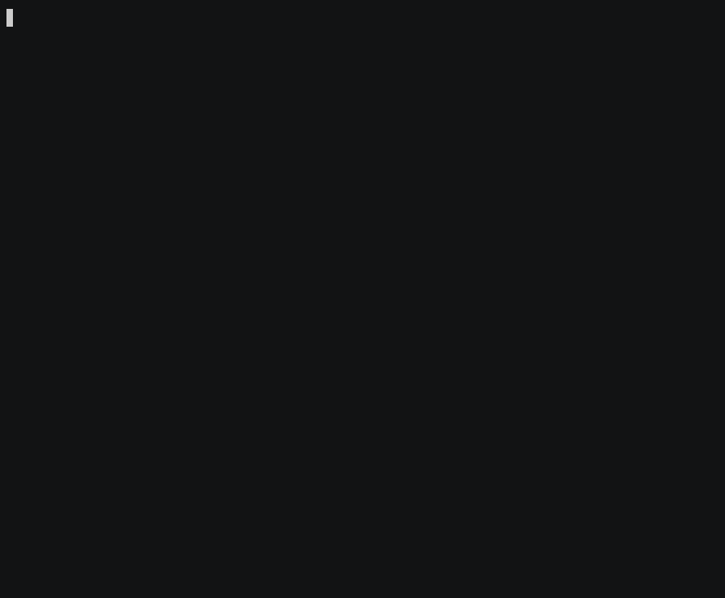

# thunderbox

A dashboard platform for the terminal. It has the shape of Grafana. A person
writes a dashboard as a document, and the dashboard reads its data from data
sources that a person can add.

thunderbox stores a dashboard. It never stores a measurement. The system that
thunderbox queries keeps the measurements.

## Learn thunderbox

The tutorials teach thunderbox one step after another. The first tutorial runs
the program on this machine.

[Watch this machine](user/tutorials/watch-this-machine.md)

## Find a fact or a task

The user documentation holds the how-to guides, the reference, and the
explanations. Each page answers one need.

[The user documentation](user/README.md)

## Work on thunderbox

The contributor documentation holds the guide, the architecture, and the
decision records of the project.

[The contributor documentation](contributor/README.md)

## The crates

Each crate below links to its API documentation.

<!-- crates:begin -->

| crate | what it holds | the crates of thunderbox that it depends on |
|---|---|---|
| [`thunderbox-core`](https://rellen.github.io/thunderbox/api/thunderbox_core/index.html) | The core types of thunderbox. This crate holds data frames, queries, and dashboards. | none |
| [`thunderbox-dashboard`](https://rellen.github.io/thunderbox/api/thunderbox_dashboard/index.html) | The dashboard runtime of thunderbox. It runs the queries and holds the state. | `thunderbox-core`, `thunderbox-source`, `thunderbox-widgets` |
| [`thunderbox-source`](https://rellen.github.io/thunderbox/api/thunderbox_source/index.html) | The data source trait and the data source registry of thunderbox. | `thunderbox-core` |
| [`thunderbox-source-prometheus`](https://rellen.github.io/thunderbox/api/thunderbox_source_prometheus/index.html) | The Prometheus data source of thunderbox. It reads a Prometheus server with a range query. | `thunderbox-core`, `thunderbox-source` |
| [`thunderbox-source-sysinfo`](https://rellen.github.io/thunderbox/api/thunderbox_source_sysinfo/index.html) | A data source that reads the processor, the memory, the network, and the processes of this machine. | `thunderbox-core`, `thunderbox-source` |
| [`thunderbox-source-testdata`](https://rellen.github.io/thunderbox/api/thunderbox_source_testdata/index.html) | A data source that makes test data for thunderbox. The data does not change between two runs. | `thunderbox-core`, `thunderbox-source` |
| [`thunderbox-widgets`](https://rellen.github.io/thunderbox/api/thunderbox_widgets/index.html) | The panel renderers of thunderbox. These widgets need no terminal backend and no async runtime. | `thunderbox-core` |

<!-- crates:end -->

A person can use thunderbox under the MIT License, or under the Apache License,
version 2.0. The section
[Licence of README.md](https://github.com/rellen/thunderbox#licence) states the
terms.

