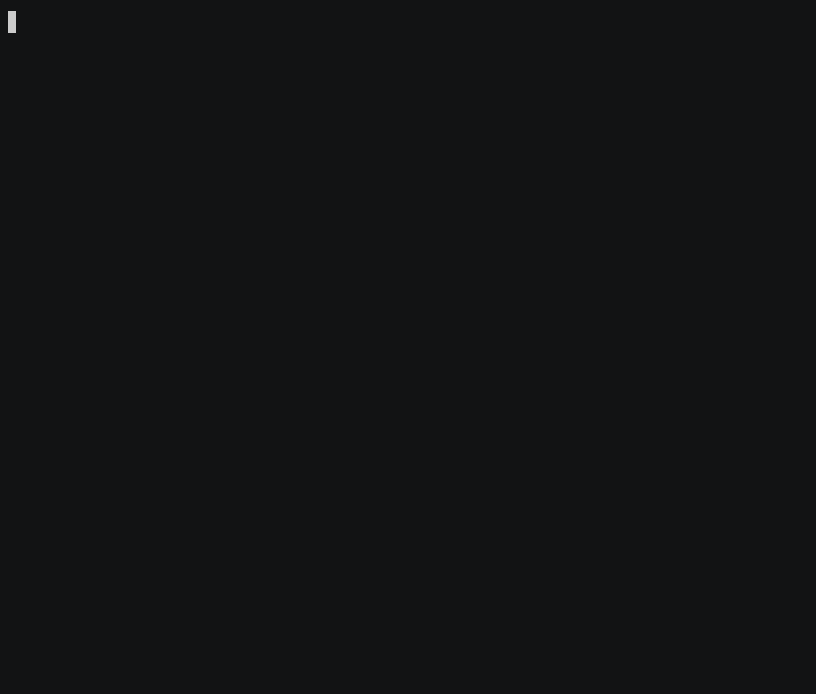

# Row panels and the place of a panel

A row panel is a line across the whole grid of a dashboard. It holds the panels
below it, and a person collapses it to hide them. This page answers these
questions:

- Why does a row panel hold its panels by their place?
- What does a collapse do to the other panels?
- What does a hidden panel cost?

The page gives no steps.
[Group panels under row panels](../how-to/group-panels-under-row-panels.md)
gives the steps, and [The dashboard file](../reference/dashboard-file.md) gives
the fields. An architecture decision record (ADR) states one decision of the
project and the reasons for it. This page summarises each idea and links to the
ADR that holds the detail.

## A row panel holds panels by their place

A row panel holds each panel that starts below its line, up to the line of the
next row panel. The file names no member of a row panel. The place of a panel on
the grid alone decides which row panel holds it. A panel above the first row
panel belongs to no row panel.

The file lists every panel in one flat list, beside the row panels. It never
puts a panel inside a row panel.

Grafana takes the other choice. Grafana is a dashboard program for the web
browser, and thunderbox has the same shape. When a person collapses a row in
Grafana, Grafana moves the panels of that row inside the row in the file. When
the person expands the row, Grafana moves those panels out of the row again.
The shape of the file then changes with the state of the screen. A reader of
such a file must know the state of each row to find a panel.

thunderbox keeps one shape. The field `collapsed` states only the state in which
a row panel starts. The program never writes the file. A person who collapses a
row panel changes the screen, and the file stays exactly as the person wrote it.

The rule needs one check. A panel that crossed the line of a row panel would
belong to two places. thunderbox therefore rejects such a dashboard before it
draws. [The dashboard file](../reference/dashboard-file.md) gives the other
rules of a row panel.
[ADR 0050](../../contributor/adr/0050-a-row-panel-holds-panels-by-their-place.md)
states the decision.

## A row panel takes one line

A row panel takes one line of the terminal, whatever the height of the terminal.
It shows a title and no data, so a second line would hold nothing. The renderer
gives each row panel one line. It then divides the other rows of the grid onto
the lines that remain.

A dashboard that holds no row panel keeps every place that it held before row
panels existed. The default dashboard of the program holds no row panel, because
it must fit a small terminal.

## A collapse gives the space to the other panels

A collapsed row panel hides the panels that it holds. The rows of the grid that
those panels held then leave the layout. The panels below the row panel move
nearer to the top of the screen, and every panel that remains grows to fill the
terminal.

The project chose this behaviour over two others. The panels below could move
but keep their size. The space of the hidden panels could also stay empty. Each
of those choices leaves rows of the terminal empty, and a terminal holds few
rows.

The line of a collapsed row panel counts the panels that it hides. The text
`The row hides 3 panels.` is an example. A person therefore knows what the line
holds without an expansion. A narrow line writes the short form `+3`.
[ADR 0051](../../contributor/adr/0051-a-row-panel-takes-one-line.md) states the
decision.

## The runtime owns the collapse

The runtime of the dashboard holds the state of each row panel. It publishes
that state together with the answers of the panels, and the renderer reads both.
The renderer and the runtime therefore always hide the same panels.

The project examined another design. In that design the code that draws holds
the state, and the program reports that state to the runtime on each wake. A
program that forgot that report would draw a panel that no query ever reached.
That panel would show `loading…` for ever, and nothing would name the fault.

The chosen design does less harm when a program forgets a step. A program that
passes no key to the row panels cannot collapse a row panel. Every panel still
holds an answer, and no panel waits for ever.
[ADR 0052](../../contributor/adr/0052-the-runtime-owns-the-collapse.md) states
the decision.

## Why a hidden panel asks for nothing

A hidden panel shows its answer to nobody. The runtime therefore asks no data
source about a panel that a collapsed row panel hides. A panel that the renderer
drops follows the same rule.
[Panels that the terminal cannot hold](panels-that-the-terminal-cannot-hold.md)
explains that rule.

A collapse that only hides panels starts no set of queries. A set of queries is
the whole group of queries that one refresh sends. The point limit is the number
of points that a panel asks a data source for. A collapse changes the width of
no panel, so it changes no point limit.

A hidden panel keeps the answer that it held. The runtime clears its error,
because no later set of queries reaches that panel. The status row must not
count an error that nobody can repair.

## Why a panel that appears asks again

A panel that appears needs an answer for the present window. A window is the
pair of moments that a time range names, and the moment that named them. The
runtime asked nothing for the panel while the panel was hidden, so its answer
can be old. An expanded row panel therefore starts a set of queries immediately.

A collapse can also show a panel. Each panel that remains grows, and a panel
that was too small to draw can reach 3 cells. That collapse starts a set of
queries as well.

Until that set answers, the panel that appeared shows the answer that it held.
A panel that never received an answer shows `loading…`. The project prefers an
old answer to an empty panel.
[ADR 0053](../../contributor/adr/0053-a-panel-that-appears-costs-a-set-of-queries.md)
states the decision.

## Why the program binds Enter and Space

A person selects a row panel with the key `Tab`. The key `Enter` or the key
`Space` then collapses or expands it. The program `thunderbox` binds those two
keys itself. The layer of the dashboard, which another program can hold,
consumes neither key.

A program that holds a dashboard often needs `Enter` for a task of its own. The
layer of the dashboard therefore offers the function `row_key`, which maps a key
to a row panel. That function answers only while the selection holds a row
panel. At every other time the program keeps both keys.
[ADR 0054](../../contributor/adr/0054-the-program-binds-enter-and-space.md)
states the decision, and
[Two ways into another program](two-ways-into-another-program.md) explains the
pattern behind it.

The key `Tab` skips each panel that a collapsed row panel hides. It still
selects a panel that the renderer drops. The dashboard layer reads a key with no
knowledge of the size of the last frame.

## Where to read more

These records hold the detail:

- [ADR 0050](../../contributor/adr/0050-a-row-panel-holds-panels-by-their-place.md):
  a row panel holds panels by their place on the grid.
- [ADR 0051](../../contributor/adr/0051-a-row-panel-takes-one-line.md):
  a row panel takes one line, and a collapse gives its rows to the other panels.
- [ADR 0052](../../contributor/adr/0052-the-runtime-owns-the-collapse.md):
  the runtime owns the collapse, and each snapshot carries it.
- [ADR 0053](../../contributor/adr/0053-a-panel-that-appears-costs-a-set-of-queries.md):
  a panel that appears costs a set of queries.
- [ADR 0054](../../contributor/adr/0054-the-program-binds-enter-and-space.md):
  the program binds `Enter` and `Space`.

These pages give the facts:

- [The panels](../reference/panels/README.md) gives the fields of a row panel.
- [The command line](../reference/command-line.md) gives each key.
