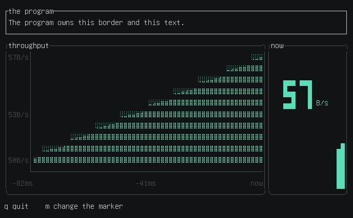
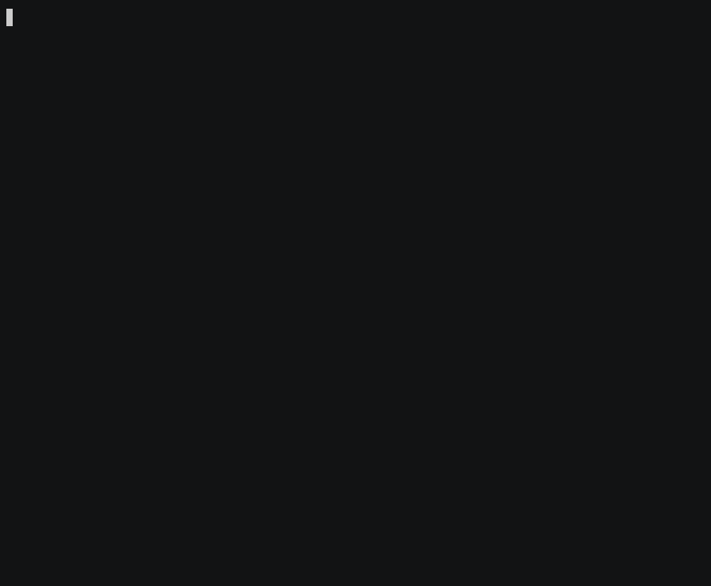

# Two ways into another program

thunderbox runs as a program of its own. It can also run inside another
program that draws on the terminal. Such a program takes thunderbox in one of
two ways: the widgets alone, or the whole dashboard. This page answers these
questions:

- When does each way fit?
- What does each layer never do?
- Why does the program bind the keys?

The page gives no steps.
[Put a panel inside your program](../tutorials/put-a-panel-inside-your-program.md)
and
[Put a dashboard inside your program](../tutorials/put-a-dashboard-inside-your-program.md)
teach the steps. [The crates](../reference/crates.md) gives each crate. An
architecture decision record (ADR) states one decision of the project and the
reasons for it. This page summarises each idea and links to the ADR that holds
the detail.

## Two layers, and not two choices

The two ways are two layers, and the larger layer uses the smaller one:

- The crate `thunderbox-widgets` holds the renderer of each kind of panel. A
  program passes its data as frames, and a panel draws them. A frame is a table
  of named columns. This layer runs no query.
- The crate `thunderbox-dashboard` reads a dashboard, runs its queries, and
  refreshes them. It holds the time range, the variables, and the panel that a
  person selected. It draws each panel with the renderers of the first layer.

[ADR 0015](../../contributor/adr/0015-both-ways-into-another-program-are-in-scope.md)
states that both ways belong to the project.

## When each way fits

Take the widgets alone when a program already holds its own data. The example
`panel_embed` makes its own signal. One function of that program builds a frame
from its data, and that function is the whole connection to thunderbox. This
way needs no async runtime. An async runtime is a library that runs many tasks
at the same time.

Take the whole dashboard when a program wants thunderbox to read the data
sources. The program then receives the features of the program `thunderbox`:

- the dashboard file;
- the data sources;
- the refresh interval;
- the time range;
- the variables;
- the row panels.

The program keeps its terminal. It gives the dashboard layer a handle, which is
a value that gives access to the async runtime of the program. The example
`full_embed` holds a whole dashboard in this way.

A program that reads its own data in some places, and a data source in other
places, can use both layers at the same time.

## Why the design starts from the way inside another program

The way inside another program is the hardest way to run thunderbox. Another
program owns the terminal, the event loop, and the keys. A design that ignored
that way would make the code that draws depend on the async runtime. A later
version would then need to separate the two. The project therefore designed for
that way first.
[ADR 0004](../../contributor/adr/0004-design-for-the-way-inside-another-program-first.md)
states the decision.

Two constraints follow from that decision:

- The widgets depend on the core parts of ratatui, which is the library that
  draws on the terminal. They hold no code that controls a terminal, they need
  no async runtime, and they read no file.
- The code that draws reads data that it already owns. No step of a frame waits
  for a query.

The program `thunderbox` holds its dashboard in the same way as any other
program. It makes the async runtime, it owns the terminal, and it reads each key
first. The project plans a way to run thunderbox through SSH, and that way can
use the same layers. Only the owner of the terminal changes.

## What each layer never does

The widgets never own the terminal. The program gives each panel an area of its
own screen, and the panel draws inside that area alone. The widgets make no
async runtime, they run no query, and they read no file.

The dashboard layer behaves as a library. It keeps these six promises:

- It never makes an async runtime. It takes a handle to the async runtime of the
  program.
- It never owns the terminal. It sets no mode of the terminal, and it reads no
  input. The program reports the size of the area of the panels, and the layer
  never measures that area itself.
- It never owns the key bindings. It reads a key only when the program passes
  that key, and it reports whether it used the key.
- It changes nothing outside itself. It installs no code that writes log
  messages, and no code that runs when the process stops on a fault or receives
  a signal.
- It stops its work when the program discards it. It ends each task that it
  started.
- It never blocks the code that draws. The code that draws reads the most
  recent answers, and it returns immediately.

The dashboard layer also starts no timer of its own, because it owns no event
loop. The program calls one method on each frame, and that method starts a
refresh when the refresh interval passes.

The reason is the same for each promise. A program that holds a dashboard
already owns the terminal, the async runtime, the keys, and the event loop. A
library that took one of them would take it from the program.

## What the program must do

The library cannot keep every rule alone. A program that holds a dashboard must
keep four rules of its own:

- The async runtime must run tasks on a thread other than the thread that
  draws. A thread is one sequence of steps that the processor runs beside other
  sequences. A runtime of one thread runs no query while the loop that draws
  waits for a key. Every panel then shows `loading…` for ever, and no error
  reaches the screen.
- The program can report the area and the marker on every frame, because the
  runtime ignores a value that did not change. The program changes the time
  range only after a key press. Each change of the time range starts a new set
  of queries, which is the whole group of queries of one refresh. A change on
  every frame would stop each set before it answers.
- A dashboard that declares no data source accepts any name of a data source.
  An embedded dashboard often declares none, because the program builds its own
  list of data sources. A wrong name then appears as an error in each panel, and
  not as an error before the program draws.
- A program can ask the runtime for a receiver, which reports each new set of
  answers. A receiver that outlives its runtime reports a refresh for ever. A
  program that reads a dashboard file again makes a new runtime, and it must
  also take a new receiver.

[ADR 0016](../../contributor/adr/0016-a-program-that-holds-a-dashboard-holds-four-rules.md)
gives each rule and its measurement.

## Why the program binds the keys

The layer of the dashboard consumes three keys alone. The keys `Tab` and
`Shift+Tab` move the selection between the panels, and the key `m` changes the
marker. The marker is the set of characters that a chart draws its points with.
The layer consumes those keys only while the dashboard has the focus of the
person. Every other key belongs to the program.

The keys of the time range, the keys of a variable, and the keys of a row panel
follow one pattern. The layer of the dashboard offers a default map for each
group: the functions `time_key`, `variable_key`, and `row_key`. Each map takes a
key and returns the change that the key asks for. No map consumes a key.
The program reads each key of its terminal, and it decides which key reaches a
map. The program then passes the change to the runtime.

The pattern has three reasons:

- A program that holds a dashboard often wants those keys for itself. The arrow
  keys, `Enter`, and `Space` are common keys of a program on the terminal. A
  library that consumed them would take them from the program.
- One map holds each rule, such as "a move is half of the width". No program
  holds a copy of that rule, so the program `thunderbox` and
  the example `full_embed` behave in the same way.
- A program that wants another rule ignores the default map. It calculates its
  own change, and it passes that change to the runtime.

[ADR 0035](../../contributor/adr/0035-the-program-binds-each-key-of-the-time-range.md)
states the rule for the time range.
[ADR 0043](../../contributor/adr/0043-the-program-binds-each-key-of-a-variable.md)
applies it to a variable, and
[ADR 0054](../../contributor/adr/0054-the-program-binds-enter-and-space.md)
applies it to a row panel.

## One cost of the widgets

The widgets take the type of an area and the type of a buffer of cells from
`ratatui-core`, which is the core crate of ratatui. A program that holds a
thunderbox panel therefore uses the release of `ratatui-core` that thunderbox
uses. A release of ratatui that changes those types also changes the interface
of thunderbox.
[ADR 0058](../../contributor/adr/0058-the-public-interface-holds-ratatui-core.md)
records that open question.

## Where to read more

These records hold the detail:

- [ADR 0004](../../contributor/adr/0004-design-for-the-way-inside-another-program-first.md):
  design for the way inside another program first.
- [ADR 0015](../../contributor/adr/0015-both-ways-into-another-program-are-in-scope.md):
  both ways into another program are in scope.
- [ADR 0016](../../contributor/adr/0016-a-program-that-holds-a-dashboard-holds-four-rules.md):
  a program that holds a dashboard holds four rules.
- [ADR 0035](../../contributor/adr/0035-the-program-binds-each-key-of-the-time-range.md):
  the program binds each key of the time range.
- [ADR 0043](../../contributor/adr/0043-the-program-binds-each-key-of-a-variable.md):
  the program binds each key of a variable.

These pages give the facts:

- [How thunderbox works](how-thunderbox-works.md) explains what the runtime
  does with the queries.
- [The crates](../reference/crates.md) gives each crate and what it holds.
