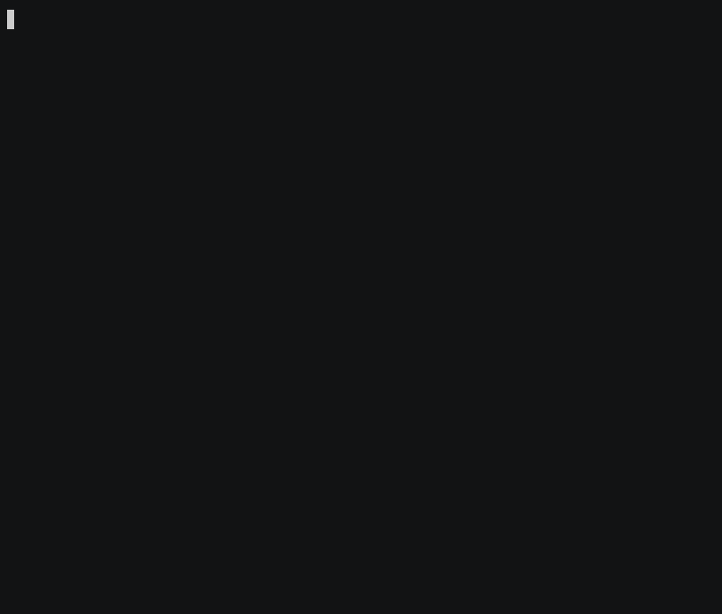

# Group panels under row panels

This guide adds row panels to a dashboard file. A row panel is a line across the
whole grid, and it holds the panels below it. A person collapses a row panel to
hide those panels.

## Add a row panel

1. Free one row of the grid above the panels that the row panel holds. Add 1 to
   the `y` of each panel at that row and below it.
2. Add a panel of the kind `row` on the free row:

   ```toml
   [[panel]]
   title = "processes"
   kind = "row"
   grid = { x = 0, y = 9, w = 24, h = 1 }
   ```

3. Write `x = 0`, `w = 24`, and `h = 1` in the field `grid` of the row panel.
4. Give the row panel no target.

The row panel holds each panel that starts below its line, up to the next row
panel. The file lists those panels beside the row panel, and never inside it.

## Collapse a row panel when the program starts

1. Add the field `collapsed = true` to the row panel.

The row panel then hides its panels until a person expands it. thunderbox asks a
data source for nothing about a hidden panel.

## Collapse and expand a row panel while the program runs

1. Press `Tab` until the selection reaches the row panel.
2. Press `Enter` or `Space`.

A collapsed row panel hides its panels, and the panels below it move nearer to
the top of the screen. The line of a collapsed row panel counts the panels
that it hides, for example `The row hides 1 panel.` Press the same key again to
expand it.



In the picture, the key `Enter` first collapses the row panel `network`, and the
panels above it grow. The same key then expands the row panel `processes`, and
the list of the processes appears. At the end, the same key expands the row
panel `network` again.

## An example

This file holds two row panels. The second row panel starts collapsed. The file
reads the test data, so it needs no server:

```toml
title = "rows"
refresh = "1s"

[source.test]
kind = "testdata"

[[panel]]
title = "load"
kind = "row"
grid = { x = 0, y = 0, w = 24, h = 1 }

[[panel]]
title = "cpu"
kind = "timeseries"
unit = "percent"
grid = { x = 0, y = 1, w = 24, h = 8 }

[[panel.target]]
source = "test"
expr = "random_walk"

[[panel]]
title = "processes"
kind = "row"
collapsed = true
grid = { x = 0, y = 9, w = 24, h = 1 }

[[panel]]
title = "the busiest processes"
kind = "top"
sort = "cpu"
grid = { x = 0, y = 10, w = 24, h = 8 }

[[panel.target]]
source = "test"
expr = "processes"
```

The file `dashboards/rows.toml` of the repository holds a larger example, with
three row panels.

## Correct a fault that the program reports

The program reads the whole file before it draws. Correct the file when the
program writes one of these faults:

| the fault | the correction |
|---|---|
| `row "processes" must span the whole grid with one row, as in grid = { x = 0, y = 9, w = 24, h = 1 }` | Write `x = 0`, `w = 24`, and `h = 1` in the field `grid` of the row panel. |
| `row "processes" holds a target. A row panel shows no data` | Remove each `[[panel.target]]` table of the row panel. |
| `panel "cpu" crosses the line of the row "processes" at y = 9` | Make the panel end at the line of the row panel, or start below it. |
| `panel "cpu" states the field collapsed. Only a panel of the kind row reads that field` | Remove the field `collapsed` from the panel. |

## Pages for the facts and the reasons

- [The row panel](../reference/panels/row.md) states each field and each rule of
  a row panel.
- [Row panels and the place of a panel](../explanation/row-panels-and-the-place-of-a-panel.md)
  states why a row panel holds panels by their place.
