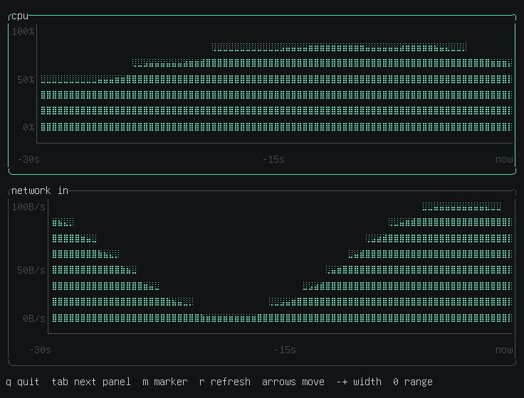

# Start each chart of a stack at the same cell

This guide makes the charts of a stack start at the same cell. A stack is the
set of panels that hold the same columns of the grid, one above another. Each
chart keeps a column for the labels of its values at its left edge, and each
chart measures that column from its own labels. Two charts of a stack can
therefore start at different cells.



In this picture, the chart `cpu` writes `100%` as its widest label, and the chart
`network in` writes `100B/s`. The chart `cpu` therefore starts two cells to the
left of the chart `network in`.

## Give the charts one start

1. Give each chart of the stack the same `x` and the same `w` in its field
   `grid`.
2. Add the field `align` at the top of the dashboard file, above the first
   table:

   ```toml
   title = "system"
   align = "column"
   ```

3. Run the program with your dashboard file.


In this picture, both charts start at the same cell, and one moment stands at
the same column on both axes of time.

## Know the limits of the rule

- The rule reaches the panels of the kind `timeseries`.
- Two charts with a different `x` or a different `w` keep their own
  measurements.
- A chart gives no more than a third of its width to the labels.
- The value `none` lets each chart measure its own labels. A dashboard file
  that states no field `align` uses that value.

## Pages for the facts and the reasons

- [The dashboard file](../reference/dashboard-file.md) states the field `align`.
- [The time series panel](../reference/panels/timeseries.md) states the column of
  the labels.
