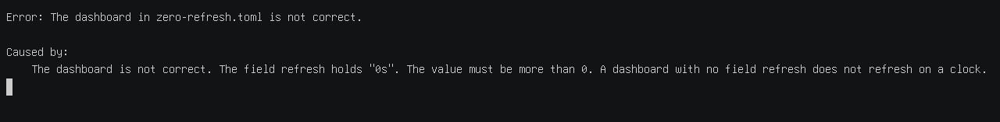

# The dashboard file

A dashboard file is a TOML file. It holds the title of the dashboard, its data
sources, its variables, and its panels. The program reads the whole file before
it opens the terminal.

The tutorial
[Write your first dashboard](../tutorials/write-your-first-dashboard.md) writes
a dashboard one step after another. This page lists each field.

## An example

```toml
title = "system"
refresh = "1s"

[time]
from = "now-5m"
to = "now"

[source.machine]
kind = "sysinfo"

[[panel]]
title = "cpu"
kind = "timeseries"
unit = "percent"
grid = { x = 0, y = 0, w = 16, h = 8 }

[[panel.target]]
source = "machine"
expr = "cpu"

[[panel]]
title = "cpu now"
kind = "stat"
unit = "percent"
grid = { x = 16, y = 0, w = 8, h = 8 }

[[panel.threshold]]
value = 85.0
color = "critical"

[[panel.target]]
source = "machine"
expr = "cpu"
```

## Types of a value

| type | the TOML form | example |
|---|---|---|
| text | A string, which is text between two quotation marks. | `"cpu"` |
| whole number | An integer, which is a number with no decimal point. | `8` |
| number | A float or an integer. A float is a number with a decimal point. | `85.0` |
| true or false | A boolean, which holds `true` or `false`. | `true` |
| list of texts | An array of strings, between two square brackets. | `["web", "db"]` |
| duration | A text that holds a whole number and a unit. The page [Time ranges](time-ranges.md#form-of-a-duration) states the form. | `"5s"` |
| moment | A text that names a point in time. The page [Time ranges](time-ranges.md#form-of-a-moment) states the form. | `"now-5m"` |
| table | A TOML table. Its name stands between two square brackets, and its fields follow it. | `[time]` |
| inline table | A TOML table on one line, between two brace brackets. | `{ x = 0, y = 0, w = 8, h = 4 }` |
| array of tables | A TOML array of tables. Its name stands between two pairs of square brackets, and the file repeats it for each item. | `[[panel]]` |

The tables below hold a column `default`. That column holds the value that the
program takes when the file omits the field. The word `none` means that the
field has no default value. The word `required` means that the file must state
the field.

## Top level

| field | type | default | what it states |
|---|---|---|---|
| `title` | text | required | The name of the dashboard. The name must hold a character that is not a space. |
| `refresh` | duration | none | The time between two sets of queries. The value must be more than 0. The duration cannot be larger than 9223372036854775807 milliseconds. |
| `align` | text | `"none"` | The rule that gives one width to the charts of a stack. |
| `[time]` | table | the last 5 minutes | The time range that every panel shares. |
| `[source.NAME]` | table | none | One data source. The file holds one such table for each data source. |
| `[[variable]]` | array of tables | none | One variable. The page [Variables](variables.md) states its fields. |
| `[[panel]]` | array of tables | none | One panel, and its place on the grid. |

### Field `refresh`

- thunderbox starts a new set of queries each time the duration passes.
- thunderbox starts no new set of queries while a set of queries still waits
  for an answer.
- The program returns an error for a duration that is larger than
  9223372036854775807 milliseconds. It writes the error before it opens the
  terminal.
- The value must be more than 0, in every unit. The program rejects `"0s"`,
  `"0ms"`, and `"0m"`, and it writes an error that names the field `refresh`.
- thunderbox starts no set of queries at a regular interval for a dashboard
  that states no `refresh`. To stop the refresh on a clock, omit the field.
- For such a dashboard, thunderbox starts a set of queries when the program
  starts. It also starts one after an event, such as the key `r` or a new time
  range.

A dashboard that states `refresh = "0s"` stops the program before it draws:



### Field `align`

The renderer is the part of thunderbox that draws the panels. The field `align`
states one rule of the renderer:

| value | what the renderer does |
|---|---|
| `"none"` | Each chart measures its own labels. |
| `"column"` | Every chart of a stack starts at the same cell. |

A stack is the set of panels that state the same `x` and the same `w`. The rule
applies to the panels of the kind `timeseries` alone. A chart gives a third of
its width or less to its labels.

The guide
[Start each chart of a stack at the same cell](../how-to/start-each-chart-of-a-stack-at-the-same-cell.md)
uses this rule.

### Table `[time]`

| field | type | default | what it states |
|---|---|---|---|
| `from` | moment | `"now-5m"` | The start of the time range. |
| `to` | moment | `"now"` | The end of the time range. |

The program ignores any other field of this table. The page
[Time ranges](time-ranges.md) states the form of a moment.

An offset of a moment holds a whole number and a unit. The duration of that
offset cannot be larger than 9223372036854775807 milliseconds.

The width of the time range must keep two limits:

- The width cannot be smaller than 1 second.
- The width cannot be larger than 3650 days.

The program returns an error for a file that does not keep a limit. It writes
the error before it opens the terminal. The section
[Second step](#second-step-dashboardvalidate) holds the texts of these errors.
The page [Time ranges](time-ranges.md#limits-of-the-width) states each limit.

### Table `[source.NAME]`

`NAME` is the name of the data source. A target and a variable refer to the data
source by this name.

| field | type | default | what it states |
|---|---|---|---|
| `kind` | text | required | The kind of the data source: `sysinfo`, `prometheus`, or `testdata`. |
| `url` | text | none | The address of the server. Only the data source `prometheus` reads this field. |
| any other field | any type | none | An option of the data source. Each data source reads its own options. |

- The program makes each data source before it opens the terminal.
- A data source returns an error for an option that it does not know.
- The data sources `sysinfo` and `testdata` ignore the field `url`.

The page [The data sources](data-sources/README.md) lists the options of each
kind.

### Table `[[panel]]`

| field | type | default | the kinds that read it | what it states |
|---|---|---|---|---|
| `title` | text | required | every kind | The name that the border of the panel shows. A row panel shows the name in its line. |
| `kind` | text | required | every kind | The kind of the panel. The page [The panels](panels/README.md) lists each kind. |
| `grid` | inline table | required | every kind | The place of the panel on the grid. |
| `unit` | text | none | `timeseries`, `stat`, `gauge`, `bargauge`, `table`, `top` | The unit of each value. The value must be `percent`, `bytes`, `bytes/s`, or `seconds`. The page [Numbers and units](numbers-and-units.md) states the rule of each unit. |
| `decimals` | whole number from 0 to 255 | none | `timeseries`, `stat`, `gauge`, `bargauge`, `table`, `top` | The number of decimal places. |
| `min` | number | none | `timeseries`, `stat`, `gauge`, `bargauge` | The smallest value of the axis, of the small chart, or of the meter. |
| `max` | number | none | `timeseries`, `stat`, `gauge`, `bargauge` | The largest value of the axis, of the small chart, or of the meter. |
| `reduce` | text | `"last"` | `stat`, `gauge`, `bargauge` | The step that reduces a column of numbers to one number. |
| `sort` | text | none | `top` | The header of the column that puts the rows in order. |
| `left` | array of text | empty | `table`, `top` | The headers of the columns that stand at the left. Each name is the text that the header of a column shows. |
| `widths` | table of whole numbers | empty | `table`, `top` | The number of cells of each named column. Each key is the text that the header of a column shows. Each value is 1 or more. The columns that state no width share the rest of the panel in equal parts. |
| `collapsed` | true or false | `false` | `row` | The state that a row panel starts in. |
| `[[panel.threshold]]` | array of tables | none | `stat`, `gauge`, `bargauge`, `table`, `top` | One bound, and the colour of a value that reaches it. |
| `[[panel.target]]` | array of tables | none | every kind except `row` | One query of the panel. |

These rules apply to the fields of a panel:

- A data source can attach a unit, decimal places, a range, and thresholds to a
  column. The field of the panel replaces the value of the column for each of
  these.
- The program matches the field `unit` against the four names exactly. The
  name `Percent` is a fault, and so is an empty name.
- A top panel applies `unit`, `decimals`, and the thresholds to one column
  alone. That column is the column that puts the rows in order.
- A data source can attach a width to a column. The field `widths` of the panel
  replaces that width for each column that it names.
- A panel ignores a field that its kind does not read, with five exceptions.
  The program rejects `sort` on a panel that is not a top panel. It rejects
  `left` and `widths` on a panel that is not a table panel or a top panel. It rejects
  `collapsed` on a panel that is not a row panel. It rejects a target on a row
  panel.
- The program rejects a `min` that is not smaller than the `max` of the same
  panel, on every kind of panel.

The page for each kind states how the panel reads each field.

#### Field `grid`

| field | type | default | what it states |
|---|---|---|---|
| `x` | whole number | required | The distance from the left edge of the grid, in grid columns. |
| `y` | whole number | required | The distance from the top of the grid, in rows of the grid. |
| `w` | whole number | required | The width, in grid columns. The value must be 1 or more. |
| `h` | whole number | required | The height, in rows of the grid. The value must be 1 or more. |

- Each value is a whole number from 0 to 65535.
- The grid is 24 columns wide. The sum of `x` and `w` must be 24 or less.
- The renderer scales the 24 columns onto the width of the terminal.
- The panel that reaches furthest down sets the number of rows of the grid. The
  renderer scales those rows onto the lines of the terminal that hold the
  panels.
- A row panel takes one line of the terminal, whatever the height of the
  terminal. The renderer scales the other rows onto the lines that remain.
- The program does not check whether two panels overlap.

#### Table `[[panel.threshold]]`

| field | type | default | what it states |
|---|---|---|---|
| `value` | number | required | The smallest value that the threshold applies to. |
| `color` | text | required | The name of the colour. The program knows the names `warning` and `critical`. A panel draws a value of any other name in its usual colour. |

The page [Numbers and units](numbers-and-units.md#thresholds) states the
rule of a threshold.

#### Table `[[panel.target]]`

| field | type | default | what it states |
|---|---|---|---|
| `source` | text | required | The name of a data source of the dashboard. |
| `expr` | text | required | The text of the query. Only the data source reads this text. The text can hold a reference to a variable. |
| `legend` | text | none | The pattern that names each series of the answer. The page [Legend patterns](legend-patterns.md) states the form. |

- A panel that holds several targets joins the answers of all of them.
- The panel runs its targets in order. It stops at the first target that
  returns an error, and the whole panel then shows that error.
- A panel that holds no target shows `no data`.
- The page [Variables](variables.md#form-of-a-reference) states the form of
  a reference to a variable.

#### A dashboard that declares no data source

The program checks the name in `source` against the data sources that the
dashboard declares. It makes that check only when the dashboard declares one
data source or more.

The program therefore accepts any name in a dashboard that declares no data
source. The program then holds no data source for such a dashboard. Each panel
that holds a target shows the error
`The registry does not hold the data source NAME.`

A program that holds a dashboard can supply its own data sources. Such a
program can read a dashboard that declares none.

## Faults that the program rejects

The program checks a dashboard in three steps. It writes the error
`The dashboard in FILE is not correct.` for a fault of the first step or of the
second step.

### First step: the TOML text

The program writes the reason of a fault under the words `Caused by:`. The
reason of a fault of this step starts with `The dashboard is not valid TOML.`
The program rejects each of these faults:

- the text is not valid TOML;
- the file omits a required field;
- a value has the wrong type;
- a whole number is outside the range of its field;
- the field `kind` of a panel, the field `align`, or the field `reduce` holds
  a value that is not in its list;
- a moment of the table `[time]` has a form that the program cannot read;
- an offset of a moment of the table `[time]` holds a duration that does not
  fit;
- the file holds a field that the program does not know. The next list names
  the places where the program makes this check.

The program rejects a field that it does not know in each of these places:

- the top level;
- a `[[panel]]` table;
- the field `grid` of a panel;
- a `[[panel.threshold]]` table;
- a `[[panel.target]]` table;
- a `[[variable]]` table.

The program ignores a field that it does not know in the table `[time]`. It
also ignores such a field in the `query` table of a variable.

The reason of a duration that does not fit has this form. The program writes
it inside the report of the TOML reader, which names the line and the column of
the field:

```
The time value "20000000000w" is not correct. A duration cannot be larger than 9223372036854775807 milliseconds.
```

### Second step: `Dashboard::validate`

The reason of a fault of this step starts with `The dashboard is not correct.`
A field `refresh` that the program cannot read is the one exception. Its
reason starts with `The time value`.

In the texts below, `NAME`, `ROW`, `SOURCE`, and the other capital words stand
for a value of the file. `FIELD` is `from` or `to`.

The program writes a moment in the largest unit that divides it exactly. A file
that holds `from = "now-300s"` therefore shows `now-5m` in the texts about the
table `[time]`. Both texts name the same moment.

| fault | the text of the error |
|---|---|
| The title is empty, or it holds spaces alone. | `title must not be empty` |
| The field `refresh` has a form that the program cannot read, or it holds a duration that does not fit. | `The time value "TEXT" is not correct.` and the reason |
| The sum of the present moment and an offset of the table `[time]` does not fit in a count of milliseconds. | `` The `[time]` table holds a `FIELD` field of VALUE. The sum of the present moment and that value does not fit in a count of milliseconds. `` |
| The time range of the table `[time]` is wider than 3650 days. | `` The `[time]` table holds a `from` field of FROM and a `to` field of TO. That range is wider than 3650 days. `` |
| The time range of the table `[time]` is narrower than 1 second. | `` The `[time]` table holds a `from` field of FROM and a `to` field of TO. That range is narrower than 1000 milliseconds. `` |
| The field `refresh` holds a duration of 0, in any unit. | `The field refresh holds "TEXT". The value must be more than 0. A dashboard with no field refresh does not refresh on a clock.` |
| A panel has a width or a height of 0. | `panel "NAME" has zero extent` |
| A panel reaches past the right edge of the grid. | `panel "NAME" spans past the 24-column grid (x=X w=W)` |
| A panel states a `unit` that is not one of the four names. | `The panel "NAME" states the unit "UNIT", and no rule knows that unit. The known units are percent, bytes, bytes/s, seconds.` |
| A panel states a `min` that is not smaller than its `max`. | `panel "NAME" has min MIN and max MAX; min must be smaller than max` |
| A panel that is not a top panel states a `sort` column. | `panel "NAME" states the sort column "COLUMN". Only a panel of the kind top reads that field` |
| A top panel states a `sort` column that has an empty name. | `panel "NAME" states a sort column with an empty name` |
| A panel that is not a table panel or a top panel states the field `left`. | `panel "NAME" states the field left. Only a panel of the kind table or top reads that field` |
| A panel states a `left` column that has an empty name. | `panel "NAME" states a left column with an empty name` |
| A panel that is not a table panel or a top panel states the field `widths`. | `panel "NAME" states the field widths. Only a panel of the kind table or top reads that field` |
| A panel states a width for a column that has an empty name. | `panel "NAME" states a width for a column with an empty name` |
| A panel states the width 0 for a column. | `panel "NAME" states the width 0 for the column "COLUMN". A width must be 1 or more` |
| A row panel does not span the whole width of the grid with one row. | `row "NAME" must span the whole grid with one row, as in grid = { x = 0, y = Y, w = 24, h = 1 }` |
| A row panel holds a target. | `row "NAME" holds a target. A row panel shows no data` |
| A panel that is not a row panel states the field `collapsed`. | `panel "NAME" states the field collapsed. Only a panel of the kind row reads that field` |
| A panel crosses the line of a row panel. | `panel "NAME" crosses the line of the row "ROW" at y = Y` |
| Two row panels stand on one line. | `panel "NAME" crosses the line of the row "ROW" at y = Y` |
| A panel names a data source that the dashboard does not declare. The program makes this check only when the dashboard declares one data source or more. | `panel "NAME" refers to undeclared source "SOURCE"` |
| A variable has a name that no query can refer to. | `variable "NAME" has a name that no query can refer to.` and the rule of a name |
| Two variables carry one name. | `the dashboard declares two variables that carry the name "NAME"` |
| A variable states no choice. | `variable "NAME" states no option and no query, so it holds no choice` |
| A variable states its choices in two places. | `variable "NAME" states both options and a query. A variable takes its choices from one place` |
| A variable states a current value that is not one of its options. | `variable "NAME" states the current value "VALUE", which is not one of its options` |
| A variable names a data source that the dashboard does not declare. The program makes this check only when the dashboard declares one data source or more. | `variable "NAME" refers to undeclared source "SOURCE"` |
| The query of a variable refers to a variable. | `variable "NAME" refers to the variable "OTHER". The query of a variable refers to no variable` |
| A panel refers to a variable that the dashboard does not declare. | `panel "NAME" refers to undeclared variable "VARIABLE"` |

The program checks every variable before it checks a panel. A dashboard can
therefore declare a variable after the panel that refers to it.

### Third step: the data sources

The program makes each data source after the two steps above. It writes the
error `The program cannot make the data sources of the dashboard.` for a fault
of this step. The program rejects each of these faults:

- a `[source.NAME]` table names a kind that this build of the program does not
  hold. The message lists the kinds that the build holds;
- a `[source.NAME]` table holds an option that its data source does not know;
- an option holds a value that its data source cannot read.

The reason of a fault of this step starts with `The dashboard is not correct.`
Two faults are the exception. They are a duration of the wrong form, and a
duration that does not fit. The reason of each starts with `The time value`.

The page [The data sources](data-sources/README.md) lists the options of each
kind, and the text of each error.

## Pages that give the reason

- [Architecture decision record 0014](../../contributor/adr/0014-the-file-format-of-a-dashboard-is-toml.md)
  states why the file format is TOML.
- [Architecture decision record 0007](../../contributor/adr/0007-the-settings-of-a-panel-win-over-the-column.md)
  states why the field of a panel replaces the value of the column.
- [Architecture decision record 0041](../../contributor/adr/0041-validate-reports-the-fault-of-a-variable.md)
  states why the program checks each variable.
- [Architecture decision record 0073](../../contributor/adr/0073-a-duration-that-does-not-fit-returns-an-error.md)
  states why a duration that does not fit returns an error.
- [Architecture decision record 0074](../../contributor/adr/0074-validate-checks-the-time-range.md)
  states why the program checks the width of the time range.
- [Row panels and the place of a panel](../explanation/row-panels-and-the-place-of-a-panel.md)
  explains why no panel crosses the line of a row panel.
