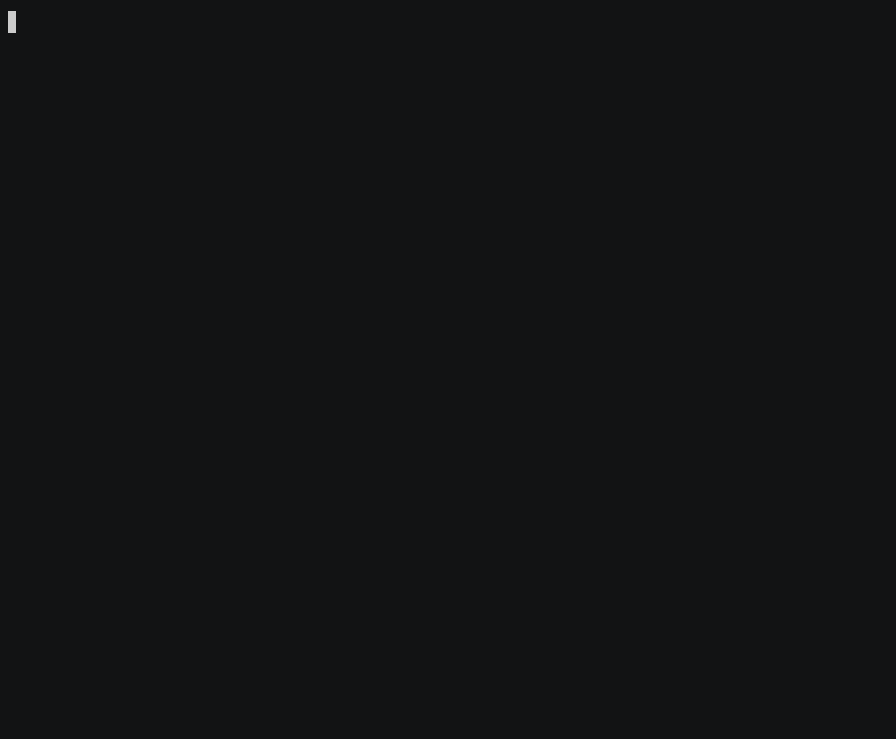

# Put a dashboard inside your program

In this tutorial, you put a whole thunderbox dashboard inside a program of your
own. thunderbox runs the queries, and it holds the state of each panel. Your
program keeps the terminal, the loop that reads the keys, and the async runtime.
An async runtime is a library that runs tasks at the same time. First you run
the example of the project. Then you build a program of the same shape, and each
step adds one part to it.

## What you need

This tutorial needs these things:

- the copy of thunderbox from [Watch this machine](watch-this-machine.md);
- Rust 1.88 or a later release;
- a text editor.

## Step 1: Run the example

1. Run this command in the folder `thunderbox`:

   ```
   cargo run -p thunderbox-dashboard --example full_embed
   ```



The text inside the top border changes after each key. It states whether the
program or thunderbox used that key. The program reads each key first, and it
gives thunderbox only the keys that it does not keep.

2. Press `q` to stop the example.

## Step 2: Make a new program

1. Run these commands in the folder `thunderbox`:

   ```
   cd ..
   cargo new my-dashboard
   cd my-dashboard
   ```

   The command `cargo new` makes the program `my-dashboard` beside the folder
   `thunderbox`.

2. Open the file `Cargo.toml` of the folder `my-dashboard`.
3. Add these six lines below the line `[dependencies]`:

   ```toml
   ratatui = "0.30"
   tokio = { version = "1", features = ["rt-multi-thread"] }
   thunderbox-core = { path = "../thunderbox/crates/thunderbox-core" }
   thunderbox-dashboard = { path = "../thunderbox/crates/thunderbox-dashboard" }
   thunderbox-source = { path = "../thunderbox/crates/thunderbox-source" }
   thunderbox-source-testdata = { path = "../thunderbox/crates/thunderbox-source-testdata" }
   ```

4. Run `rustc --version` in the folder `my-dashboard`. Run `rustup update` when
   the release is older than 1.88.

The crates of thunderbox are not on crates.io. The four lines that name a crate
of thunderbox therefore give the path of a folder of your copy. The crate
`tokio` is the async runtime.

## Step 3: Run a dashboard

1. Replace the whole text of `src/main.rs` with this text:

   ```rust
   use std::error::Error;
   use std::sync::Arc;
   use std::time::Duration;

   use ratatui::DefaultTerminal;
   use ratatui::crossterm::event::{self, Event, KeyCode, KeyEventKind};
   use ratatui::layout::{Constraint, Layout, Size};
   use ratatui::widgets::{Block, Paragraph};
   use thunderbox_core::Dashboard;
   use thunderbox_dashboard::{DashboardRuntime, DashboardView};
   use thunderbox_source::Registry;
   use thunderbox_source_testdata::TestData;

   const DASHBOARD: &str = r#"
   title = "my dashboard"
   refresh = "1s"

   [time]
   from = "now-5m"
   to = "now"

   [source.test]
   kind = "testdata"

   [[panel]]
   title = "cpu"
   kind = "timeseries"
   unit = "percent"
   grid = { x = 0, y = 0, w = 16, h = 8 }
   [[panel.target]]
   source = "test"
   expr = "random_walk"

   [[panel]]
   title = "cpu now"
   kind = "stat"
   unit = "percent"
   grid = { x = 16, y = 0, w = 8, h = 8 }
   [[panel.target]]
   source = "test"
   expr = "random_walk"
   "#;

   fn main() -> Result<(), Box<dyn Error>> {
       // The program makes the async runtime, and thunderbox runs its queries on it.
       let runtime = tokio::runtime::Builder::new_multi_thread()
           .enable_all()
           .build()?;

       let dashboard = Dashboard::from_toml(DASHBOARD)?;
       let sources = Registry::new().with("test", Arc::new(TestData::new()));
       let mut dash = DashboardRuntime::new(dashboard, sources, runtime.handle().clone())?;

       let mut terminal = ratatui::init();
       let result = run(&mut terminal, &mut dash);
       ratatui::restore();
       result
   }

   fn run(terminal: &mut DefaultTerminal, dash: &mut DashboardRuntime) -> Result<(), Box<dyn Error>> {
       let view = DashboardView::new();
       loop {
           let snapshot = dash.snapshot();
           let mut panel_area = Size::new(0, 0);

           terminal.draw(|frame| {
               let [top, middle] =
                   Layout::vertical([Constraint::Length(3), Constraint::Min(10)]).areas(frame.area());

               let text = Paragraph::new("My program owns this border and this text.")
                   .block(Block::bordered().title("my program"));
               frame.render_widget(text, top);

               // thunderbox draws the dashboard inside the area that the program gives it.
               view.render(dash.dashboard(), &snapshot, middle, frame.buffer_mut());
               panel_area = middle.as_size();
           })?;

           // The program reports the area of the panels, and it drives the refresh.
           dash.set_panel_area(panel_area);
           dash.tick();

           if event::poll(Duration::from_millis(100))? {
               if let Event::Key(key) = event::read()? {
                   if key.kind == KeyEventKind::Press && key.code == KeyCode::Char('q') {
                       return Ok(());
                   }
               }
           }
       }
   }
   ```

2. Run this command:

   ```
   cargo run
   ```

Cargo builds the program. The program draws its own border at the top, and
thunderbox draws two panels below it. The chart shows the last 5 minutes of the
signal `random_walk`.

The program works in this way:

- The constant `DASHBOARD` holds a dashboard file, as text.
- A `Registry` holds each data source of the program under a name. This
  program gives the name `test` to a data source of the test data. The target
  of each panel names that data source.
- The program makes the async runtime. It gives thunderbox a handle of that
  runtime, which is a value that lets thunderbox start tasks on it. thunderbox
  runs each query as such a task.
- On each pass of the loop, the program draws, and it then reports the area of
  the panels. It also calls `tick` on each pass. That call starts the queries
  again when 1 second has passed, because the dashboard states
  `refresh = "1s"`.

3. Press `q` to stop the program.

## Step 4: Give the keys to thunderbox

1. Replace the line that starts with `use thunderbox_dashboard` with this line:

   ```rust
   use thunderbox_dashboard::{DashboardRuntime, DashboardView, Key};
   ```

2. Replace the whole function `run` with this text:

   ```rust
   fn run(terminal: &mut DefaultTerminal, dash: &mut DashboardRuntime) -> Result<(), Box<dyn Error>> {
       let mut view = DashboardView::new();
       loop {
           let snapshot = dash.snapshot();
           let mut panel_area = Size::new(0, 0);

           terminal.draw(|frame| {
               let [top, middle] =
                   Layout::vertical([Constraint::Length(3), Constraint::Min(10)]).areas(frame.area());

               let text = Paragraph::new("My program owns this border and this text.")
                   .block(Block::bordered().title("my program"));
               frame.render_widget(text, top);

               // thunderbox draws the dashboard inside the area that the program gives it.
               view.render(dash.dashboard(), &snapshot, middle, frame.buffer_mut());
               panel_area = middle.as_size();
           })?;

           // The program reports the area of the panels and the marker, and it
           // drives the refresh.
           dash.set_panel_area(panel_area);
           dash.set_marker(view.marker());
           dash.tick();

           if event::poll(Duration::from_millis(100))? {
               if let Event::Key(key) = event::read()? {
                   if key.kind != KeyEventKind::Press {
                       continue;
                   }
                   // The program reads each key first, and it keeps the key q.
                   if key.code == KeyCode::Char('q') {
                       return Ok(());
                   }
                   // The program gives every other key to thunderbox.
                   let translated = match key.code {
                       KeyCode::Tab => Key::Tab,
                       KeyCode::BackTab => Key::BackTab,
                       KeyCode::Char(c) => Key::Char(c),
                       _ => Key::Other,
                   };
                   view.handle_key(translated, dash.dashboard(), &snapshot);
               }
           }
       }
   }
   ```

3. Run `cargo run` again.
4. Press `Tab`.

The cyan border moves from the chart to the stat panel. Your program kept the
key `q`, and it gave the key `Tab` to thunderbox.

5. Press `m`.

The chart draws each point with another glyph. A glyph is the set of
characters that draws the points of a chart. Press `m` three more times, and
the chart returns to the first glyph. The program reports the glyph to
thunderbox with the method `set_marker`, because the glyph changes the number
of points that each panel asks for.

6. Press `q` to stop the program.

## Step 5: Move the time range

1. Replace the two lines that start with `use thunderbox_core` and
   `use thunderbox_dashboard` with these two lines:

   ```rust
   use thunderbox_core::{Dashboard, now_ms};
   use thunderbox_dashboard::{DashboardRuntime, DashboardView, Key, time_key};
   ```

2. Replace the whole function `run` with this text:

   ```rust
   fn run(terminal: &mut DefaultTerminal, dash: &mut DashboardRuntime) -> Result<(), Box<dyn Error>> {
       let mut view = DashboardView::new();
       loop {
           let snapshot = dash.snapshot();
           let mut panel_area = Size::new(0, 0);

           terminal.draw(|frame| {
               let [top, middle] =
                   Layout::vertical([Constraint::Length(3), Constraint::Min(10)]).areas(frame.area());

               let text = Paragraph::new("My program owns this border and this text.")
                   .block(Block::bordered().title("my program"));
               frame.render_widget(text, top);

               // thunderbox draws the dashboard inside the area that the program gives it.
               view.render(dash.dashboard(), &snapshot, middle, frame.buffer_mut());
               panel_area = middle.as_size();
           })?;

           // The program reports the area of the panels and the marker, and it
           // drives the refresh.
           dash.set_panel_area(panel_area);
           dash.set_marker(view.marker());
           dash.tick();

           if event::poll(Duration::from_millis(100))? {
               if let Event::Key(key) = event::read()? {
                   if key.kind != KeyEventKind::Press {
                       continue;
                   }
                   // The program reads each key first, and it keeps the key q.
                   if key.code == KeyCode::Char('q') {
                       return Ok(());
                   }
                   // The program gives every other key to thunderbox.
                   let translated = match key.code {
                       KeyCode::Tab => Key::Tab,
                       KeyCode::BackTab => Key::BackTab,
                       KeyCode::Left => Key::Left,
                       KeyCode::Right => Key::Right,
                       KeyCode::Char(c) => Key::Char(c),
                       _ => Key::Other,
                   };
                   // A key of the time range asks for a new range.
                   let declared = &dash.dashboard().time;
                   if let Some(range) = time_key(translated, dash.time_range(), declared, now_ms()) {
                       dash.set_time_range(range);
                       continue;
                   }
                   view.handle_key(translated, dash.dashboard(), &snapshot);
               }
           }
       }
   }
   ```

3. Run `cargo run` again.
4. Press the key `Left`.

The time range moves back by half of its width. The last label of the axis of
time is not `now`. The panels now show a fixed part of the past, and that part
does not move with the clock.

5. Press `0`.

The time range returns to the last 5 minutes, and it follows the clock again.

6. Press `q` to stop the program.

thunderbox reads no key of the time range by itself. The function `time_key`
holds the rule that turns a key into a time range, and your program decides
which key reaches that function.

## What you did

- You gave thunderbox a dashboard, a data source, and a handle of your async
  runtime.
- You drew the dashboard inside an area of your own terminal.
- You kept one key for your program, and you gave the other keys to thunderbox.
- You moved the time range with the rule of thunderbox.

## Next step

- Read the example `crates/thunderbox-dashboard/examples/full_embed.rs` of your
  copy. It also binds the keys of a variable and the keys of a row panel. It
  also draws a frame only when the screen can change, and the loop of this
  tutorial draws a frame on each pass. Copy that decision when your program
  must use little processor time.
- Read [Two ways into another program](../explanation/two-ways-into-another-program.md)
  to choose between the two ways.
- Read [The crates](../reference/crates.md) for the crates that a program uses.
- Read [The command line](../reference/command-line.md) for the keys of the
  program `thunderbox`.
