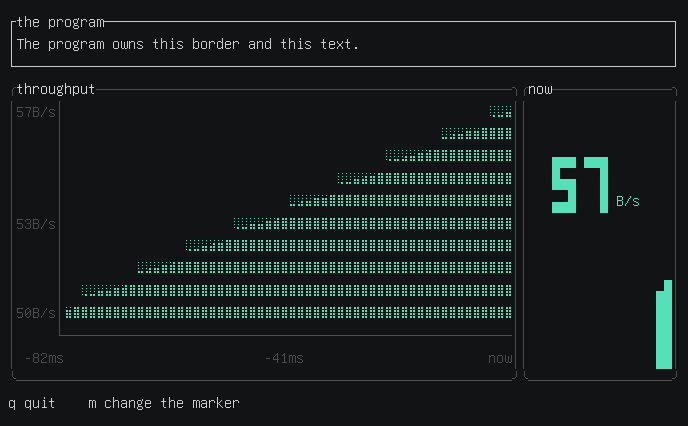

# Put a panel inside your program

In this tutorial, you write a small program that draws its own data. Your
program owns the terminal, and thunderbox draws two panels inside it. First you
run the example of the project, and you see the result. Then you build a program
of the same shape, and each step adds one part to it.

## What you need

This tutorial needs these things:

- the copy of thunderbox from [Watch this machine](watch-this-machine.md);
- Rust 1.88 or a later release;
- a text editor.

## Step 1: Run the example

1. Run this command in the folder `thunderbox`:

   ```
   cargo run -p thunderbox-widgets --example panel_embed
   ```



The border and the text at the top belong to the program, and the two panels
below them come from thunderbox. Your program draws the same three parts at the
end of this tutorial.

2. Press `q` to stop the example.

## Step 2: Make a new program

1. Run these commands in the folder `thunderbox`:

   ```
   cd ..
   cargo new my-panel
   cd my-panel
   ```

   The command `cargo new` makes the program `my-panel` beside the folder
   `thunderbox`.

2. Open the file `Cargo.toml` of the folder `my-panel`.
3. Add these three lines below the line `[dependencies]`:

   ```toml
   ratatui = "0.30"
   thunderbox-core = { path = "../thunderbox/crates/thunderbox-core" }
   thunderbox-widgets = { path = "../thunderbox/crates/thunderbox-widgets" }
   ```

4. Run `rustc --version` in the folder `my-panel`. Run `rustup update` when the
   release is older than 1.88.

The crates of thunderbox are not on crates.io. The two lines that name a crate
of thunderbox therefore give the path of a folder of your copy. The crate
`ratatui` draws on the terminal.

## Step 3: Own the terminal

1. Replace the whole text of `src/main.rs` with this text:

   ```rust
   use std::io;
   use std::time::Duration;

   use ratatui::DefaultTerminal;
   use ratatui::crossterm::event::{self, Event, KeyCode};
   use ratatui::widgets::{Block, Paragraph};

   fn main() -> io::Result<()> {
       let mut terminal = ratatui::init();
       let result = run(&mut terminal);
       ratatui::restore();
       result
   }

   fn run(terminal: &mut DefaultTerminal) -> io::Result<()> {
       loop {
           terminal.draw(|frame| {
               let text = Paragraph::new("My program owns this border and this text.")
                   .block(Block::bordered().title("my program"));
               frame.render_widget(text, frame.area());
           })?;

           if event::poll(Duration::from_millis(100))? {
               if let Event::Key(key) = event::read()? {
                   if key.code == KeyCode::Char('q') {
                       return Ok(());
                   }
               }
           }
       }
   }
   ```

2. Run this command:

   ```
   cargo run
   ```

Cargo builds the program, and the program draws a border with the title
`my program`. Your program owns this border, and it reads each key itself.

3. Press `q` to stop the program.

## Step 4: Give your data to a chart

1. Replace the whole text of `src/main.rs` with this text:

   ```rust
   use std::io;
   use std::time::{Duration, Instant};

   use ratatui::DefaultTerminal;
   use ratatui::crossterm::event::{self, Event, KeyCode};
   use ratatui::layout::{Constraint, Layout};
   use ratatui::widgets::{Block, Paragraph};
   use thunderbox_core::{Field, Frame};
   use thunderbox_widgets::{PanelData, Theme, TimeSeriesPanel};

   /// The data of the program. Each sample holds a time and a value.
   struct Samples {
       started: Instant,
       points: Vec<(i64, f64)>,
   }

   impl Samples {
       fn new() -> Self {
           Self {
               started: Instant::now(),
               points: Vec::new(),
           }
       }

       /// Adds one sample. The value rises and falls like a wave.
       fn add(&mut self) {
           let time = self.started.elapsed().as_millis() as i64;
           let value = 50.0 + 40.0 * (time as f64 / 1000.0).sin();
           self.points.push((time, value));
           if self.points.len() > 600 {
               self.points.remove(0);
           }
       }

       /// Returns the samples as a thunderbox frame.
       fn to_frames(&self) -> Vec<Frame> {
           let times = self.points.iter().map(|(time, _)| *time).collect();
           let values = self.points.iter().map(|(_, value)| Some(*value)).collect();
           vec![Frame::new(vec![
               Field::time("time", times),
               Field::f64("load", values),
           ])]
       }
   }

   fn main() -> io::Result<()> {
       let mut terminal = ratatui::init();
       let result = run(&mut terminal);
       ratatui::restore();
       result
   }

   fn run(terminal: &mut DefaultTerminal) -> io::Result<()> {
       let theme = Theme::default();
       let mut samples = Samples::new();
       loop {
           samples.add();
           let frames = samples.to_frames();
           terminal.draw(|frame| draw(frame, &frames, &theme))?;

           if event::poll(Duration::from_millis(100))? {
               if let Event::Key(key) = event::read()? {
                   if key.code == KeyCode::Char('q') {
                       return Ok(());
                   }
               }
           }
       }
   }

   fn draw(frame: &mut ratatui::Frame, frames: &[Frame], theme: &Theme) {
       let [top, bottom] =
           Layout::vertical([Constraint::Length(3), Constraint::Min(6)]).areas(frame.area());

       let text = Paragraph::new("My program owns this border and this text.")
           .block(Block::bordered().title("my program"));
       frame.render_widget(text, top);

       let chart = TimeSeriesPanel::new("load", PanelData::Frames(frames), theme);
       frame.render_widget(chart, bottom);
   }
   ```

2. Run `cargo run` again.

A chart with the title `load` now stands below the border. Its line rises and
falls, and it moves to the left while you watch.

The method `to_frames` is the whole connection between your data and
thunderbox. A frame holds columns. This frame holds one column of times, and one
column of numbers. The chart reads the frame, and it never asks your program for
anything else.

The crate `ratatui` also holds a type with the name `Frame`. The program
therefore writes `ratatui::Frame` for the type of ratatui, and `Frame` for the
frame of thunderbox.

3. Press `q` to stop the program.

## Step 5: Add a number that changes colour

1. Replace the two lines that start with `use thunderbox` with these two lines:

   ```rust
   use thunderbox_core::{Field, Frame, Threshold};
   use thunderbox_widgets::{PanelData, PanelOptions, StatPanel, Theme, TimeSeriesPanel};
   ```

2. Replace the whole function `draw` with this text:

   ```rust
   fn draw(frame: &mut ratatui::Frame, frames: &[Frame], theme: &Theme) {
       let [top, bottom] =
           Layout::vertical([Constraint::Length(3), Constraint::Min(6)]).areas(frame.area());
       let [left, right] =
           Layout::horizontal([Constraint::Min(20), Constraint::Length(20)]).areas(bottom);

       let text = Paragraph::new("My program owns this border and this text.")
           .block(Block::bordered().title("my program"));
       frame.render_widget(text, top);

       // A value of 80 or more takes the colour red.
       let thresholds = [Threshold {
           value: 80.0,
           color: "critical".into(),
       }];
       let options = PanelOptions {
           unit: Some("percent"),
           thresholds: &thresholds,
           ..Default::default()
       };

       let chart = TimeSeriesPanel::new("load", PanelData::Frames(frames), theme).options(options);
       frame.render_widget(chart, left);

       let number = StatPanel::new("now", PanelData::Frames(frames), theme).options(options);
       frame.render_widget(number, right);
   }
   ```

3. Run `cargo run` again.

A stat panel with the title `now` stands to the right of the chart. It shows the
most recent value as one large number. The number is red each time that the
value reaches 80 or more.

Both panels read the same `PanelOptions` value. The field `unit` gives each
number the symbol `%`. The field `thresholds` holds the bound of 80 and the
colour `critical`.

4. Press `q` to stop the program.

## What you did

- You made a program that owns its terminal and its keys.
- You turned the data of your program into a frame.
- You drew two thunderbox panels from that frame, and you gave them a unit and
  a threshold.

Your program holds no data source and no dashboard file of thunderbox. It also
holds no async runtime, which is a library that runs tasks at the same time.

## Next step

- Follow [Put a dashboard inside your program](put-a-dashboard-inside-your-program.md)
  to let thunderbox run the queries for you.
- Read [Two ways into another program](../explanation/two-ways-into-another-program.md)
  to choose between the two ways.
- Read [The crates](../reference/crates.md) for the crates that a program uses.
- Read [The panels](../reference/panels/README.md) for each kind of panel.
