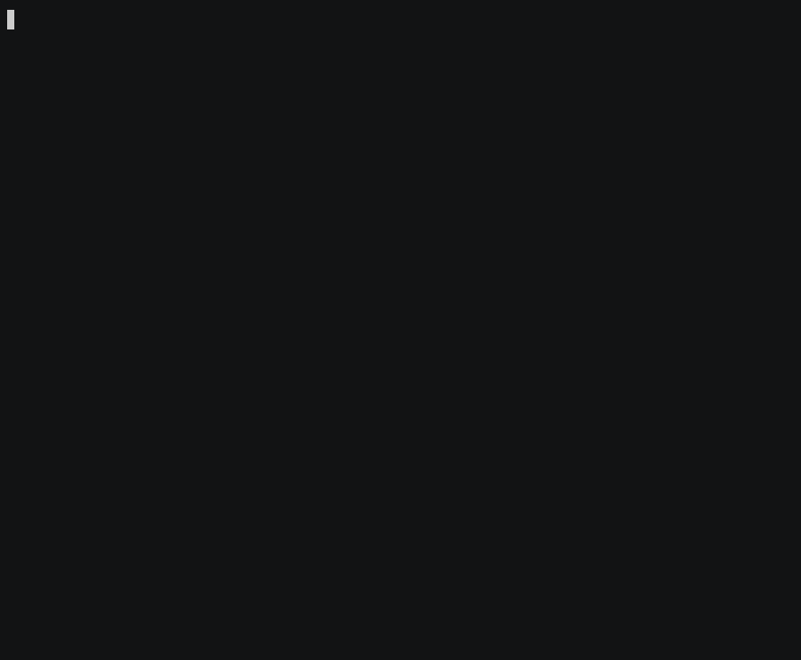

# Watch this machine

In this tutorial, you run thunderbox on your own machine. You read each panel
of the dashboard that the program holds. Then you make one process busy, and you
find that process in the list of the processes.

## What you need

This tutorial needs these things:

- a machine that runs Linux or macOS;
- Git;
- Rust and Cargo, which rustup installs from <https://rustup.rs>;
- a terminal of 80 columns and 24 rows, or a larger terminal.

## Step 1: Get a copy of thunderbox

1. Open a terminal.
2. Run these two commands:

   ```
   git clone https://github.com/rellen/thunderbox
   cd thunderbox
   ```

The folder `thunderbox` now holds a copy of the code. The later tutorials use
this copy too.

## Step 2: Start the program

1. Run this command in the folder `thunderbox`:

   ```
   cargo run -p thunderbox
   ```

Cargo builds the program first, and the first build takes a few minutes. The
program then fills the terminal with seven panels.

The file `rust-toolchain.toml` of the copy names one release of Rust. The
command can report that your machine does not hold that release. When it does,
run `rustup toolchain install` in the same folder. Then run the command of this
step again.



Compare the place of each panel in the picture with the place of the same panel
on your screen. The picture shows the test data of this project, so its numbers
are not the numbers of your machine.

## Step 3: Read the top row

The top row holds two panels:

- The panel `cpu` draws the share of the processor that is in use, across every
  core. The chart shows the last 2 minutes. The program holds no value from
  before it started, so the line starts at the right edge and grows to the left.
- The panel `cpu now` shows the same share as one large number. The number is
  yellow at 60 or more, and it is red at 85 or more.

## Step 4: Read the middle row

The middle row holds three panels:

- The panel `memory` is a meter from 0 to 100. It shows the share of the memory
  that is in use. The meter is yellow at 70 or more, and it is red at 90 or
  more.
- The panel `cores` holds one bar for each core, with the names `core 0`,
  `core 1`, and one name for each other core. A bar is red at 80 or more.
- The panel `network` draws two lines. One line shows the bytes that the network
  cards received in each second. The other line shows the bytes that they sent.

## Step 5: Read the bottom row

The bottom row holds two panels:

- The panel `the most recent rows for each core` is a table. Each row holds one
  sample, and the newest row is at the bottom. The first column holds the time
  of the sample, in Coordinated Universal Time.
- The panel `processes` holds one row for each process of the machine. The
  busiest process comes first.

The panel `processes` holds four columns:

| column | what it shows |
|---|---|
| `pid` | The number of the process. The panel writes every digit of it, at the right of the column. |
| `name` | The name of the program that the process runs. |
| `cpu` | The share of the processor that the process used since the sample before. A value of 100 is one whole core. |
| `MemB` | The memory that the process holds, in bytes. The panel writes the letter of the scale alone, as in `855M`. |

A line under the header `cpu` marks the column that gives the order. The bottom
border counts the rows that do not fit, for example `74 rows do not fit.`

## Step 6: Make one process busy

1. Open a second terminal.
2. Run this command in the second terminal:

   ```
   yes > /dev/null
   ```

3. Return to the terminal of thunderbox.

The program `yes` writes the letter `y` until you stop it, and `/dev/null`
discards each letter. The process therefore keeps one core busy.

After a few seconds, the row of `yes` stands at the top of the panel
`processes`. Its share is near `100%`, which is one whole core. The panel draws
that share in red, because the share is 85 or more. In the panel `cores`, one
bar also rises.

## Step 7: Stop the busy process

1. Press `Ctrl+C` in the second terminal.

After the next refresh, the row of `yes` is not in the list.

## Step 8: Select a panel

The panel that holds the selection has a cyan border. When the program starts,
the panel `cpu` holds the selection.

1. Press `Tab`. The cyan border moves to the next panel.
2. Press `Shift+Tab`. The cyan border moves to the panel before.

## Step 9: Stop thunderbox

1. Press `q`.

The program stops, and the terminal shows the command line again.

## What you did

- You built thunderbox, and you ran it.
- You read each panel of the dashboard that the program holds.
- You found the busiest process of your machine.

## Next step

- Follow [Write your first dashboard](write-your-first-dashboard.md) to make a
  dashboard of your own.
- Read [The command line](../reference/command-line.md) for every key.
- Read [How thunderbox works](../explanation/how-thunderbox-works.md) to learn
  how a panel gets its data.
